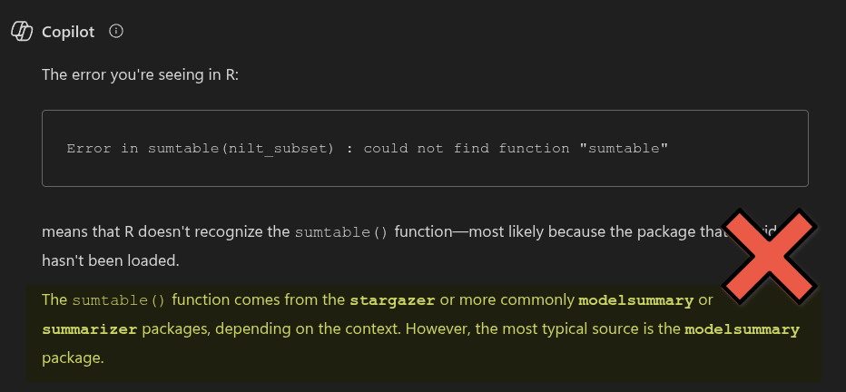
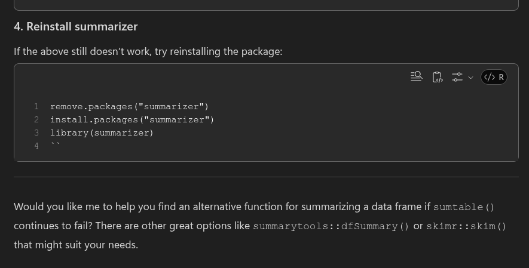

A recurring source of issues across courses - but especially one's involving
coding - is genAI leading people astray. GenAI can be useful when you have a
general understanding of the area / topic you are using it for. However, it is
nowhere near as competent as the genAI companies and online grifters make it out
to be. If you do not understand the area / topic you are prompting it about, you
will not know when its responses contain inaccuracies or outright
misinformation.

Indeed, all genAI responses are
[bullshit](https://link.springer.com/article/10.1007/s10676-024-09775-5) - and I
use that as the correct philosophical term to describe it. GenAI does not
distinguish between fact and fiction, it merely selects the next most probable
token - which for simplicity sake can think of as a word - based on the tokens
fed to it.

People claim genAI is 'good' at writing code. It is not. It can produce
functional code which is not the same as good code. GenAI when prompted about R
will respond with misinformation or needlessly complex code. Even where the code
it spits out works, which is never guaranteed, it can be 20+ lines of code for
something that could do with 1-4 lines of code instead *and* receive a nicer
result.

For example, here is Copilot's bullshit response to a common error students
experience on one of our undergraduate modules:



This error message occurs if you try to use the `sumtable()` function without
first loading the `vtable` package that provides it. Despite that, Copilot
advises installing three packages - `stargazer`, `modelsummary`, and
`summarizer` - none of which provide a `sumtable()` function.

Yet, after I tell Copilot installing those packages did not solve the issue it
continues bullshitting me:



So - First, Copilot advised me to install the wrong three packages. Second, when
I informed it that didn't work, it advised me to try various other things,
including uninstalling and reinstalling the packages. Third, it then suggested
if all that still doesn't work - which it won't - that it can give me
information on 'alternatives'.

Two responses and it has wasted my time and rapidly led me further and further
away from the simple quick solution for the error - installing and loading the
`vtable` package.

```{r}
#| eval: false

# Run in Console
install.packages("vtable")
# Add to R Markdown file
library(vtable)
```

If you put too much faith into genAI bullshit you risk needless frustration -
and potentially losing hours of time. A related issue students often encounter
on the same module can be fixed by simply removing a single line of code. Yet
genAI will repeatedly fail to solve the problem and eventually provide 200+
lines of code to copy and paste as a workaround. Whilst that code will sometimes
'work' it is a bad solution to an incredibly simple problem.

Combined with all its other flaws - such as a tendency to write code that is
hard to read - over-reliance on genAI can leave beginners with a misleading
sense that coding is more difficult and complex than it actually is in practice.
