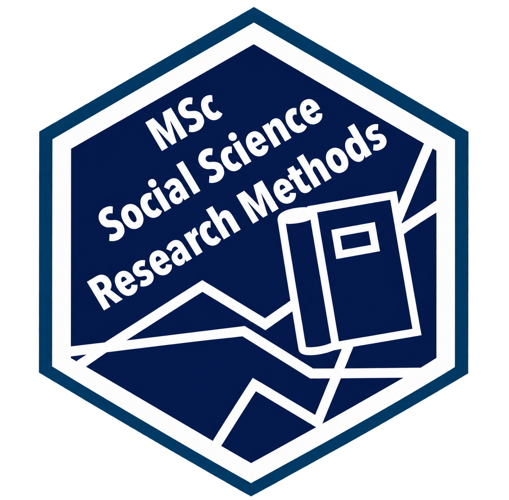

::: {.split .align-items-center narrow-first=right}
::::: {.split-left}


An introdution to digital data and a guide through the process of sourcing data
that critically engages with standards of sampling and representation to produce
new and useful datasets.

::::::: {.button-row}
[Course Moodle](){.button .external target="_blank"}

[Course information](course-info.qmd){.button}
:::::::
:::::
::::: {.split-right .text-center}
{width=100% style="max-width:26rem" fig-alt="Course logo"}
:::::
:::

::: {.callout-note appearance="simple"}
These pages provide online materials for a course at the University of Glasgow
that is part of the [MSc Social Science Research
Methods](https://www.gla.ac.uk/postgraduate/taught/social-science-research-methods/)
programme. They are also made available as open educational resources. The
course Moodle pages contain additional course information and assessment
submission areas, and are only available to current UofG students.



Made with
[](https://www.r-project.org/){.linked-icon}
and
{height=1em}
[Quarto](https://quarto.org). Colour scheme
{height=1em}
[Catppuccin](https://catppuccin.com).
:::

::: {.callout-caution appearance="simple"}
As this is the first year the course is running pages are work-in-progress and
will be added to as we go. Please let me know if any information is unclear or
if you are experiencing any issues working with the data you have choosen for
your data project.
:::

::: {.surface colour=blue}
::::: {.content-columns}
::: {title="Teaching Staff" icon="[]{.bi .bi-person-fill}"}
****\
\


****\
\

:::
::: {title="Timetabling" icon="[]{.bi .bi-calendar-event-fill}"}
**Classes**\
Tuesdays, 1pm–4pm\

**Office hours**\
Thursdays, 2pm–4pm\
By appointment\
Book [in-person](test.com) or [online](test.com) slots.
:::
::: {title="Don't Panic!" icon="[]{.bi .bi-hand-thumbs-up-fill}"}

We will flesh out additional pages in response to any questions, queries, or issues. This includes:

[Reference materials](reference/dont-panic.qmd)\
[Assessments FAQ](assessments/assessments-faq.qmd)
:::
:::::
:::
