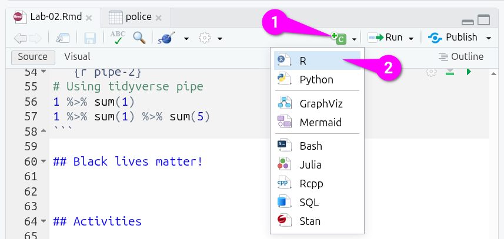
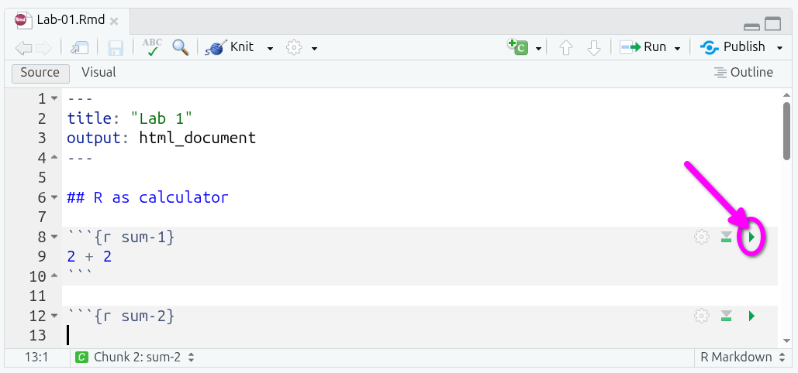
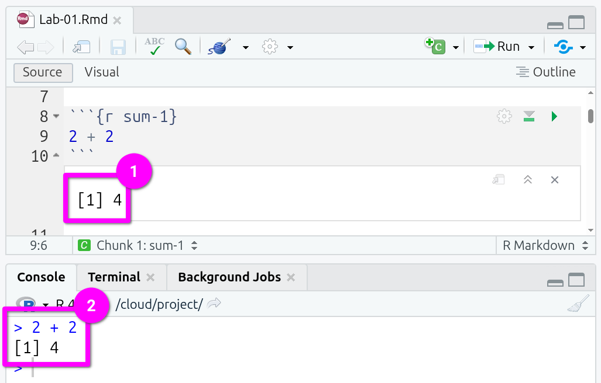
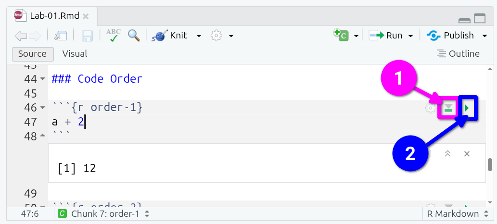
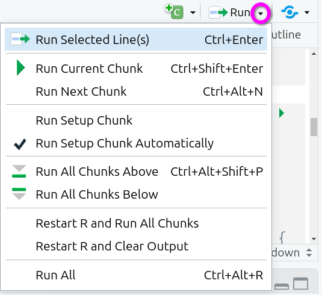
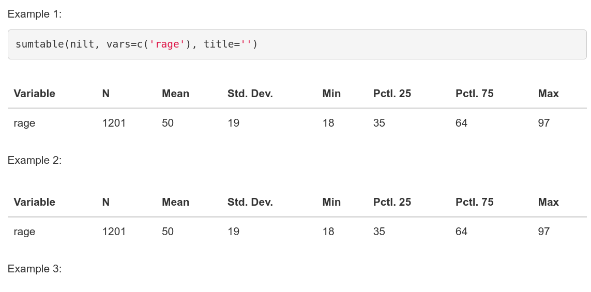
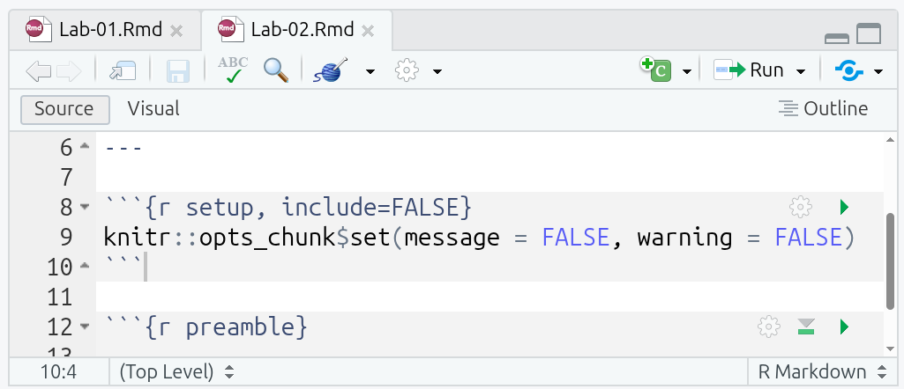

A code chunk is a "fenced" block (it is enclosed above and below with ```` ``` ````) in an R Markdown file for adding R code. These can then be run within RStudio and are used when 'knitting' R Markdown files to HTML, PDF, or Word documents.

## Writing a code chunk {#writing}

### The parts of a code chunk {#parts}

In most colour schemes, code chunks have a different shaded background in RStudio. If using the default light colour scheme the background is a light gray.

The general shape of a code chunk:

````markdown {filename="Template"}
```{{r CHUNK_NAME, OPTION = VALUE}}
# (optionally) use '#' at start of line to add comments
CODE
```
````

- Three back-ticks open the chunk with curly brackets to specify `{programming-language optional-name, any-options = values}`.
- Since we are using R, all our code chunks have `{r ...}`. `CHUNK_NAME` (the 'label') and `OPTION = VALUE` are both optional. A chunk takes one label at most, but can take several options, separated by commas (see [Chunk labels](#labels) and [Chunk options](#options)).
- Within code chunks, the pound sign / hash, `#`, at the start of a line is used to add any comments (see [Comments](r-syntax.qmd#comments) on the R syntax page, and, for why `#` makes a header outside a chunk instead, [the R Markdown page](r-markdown.qmd#hash)]).
- `CODE` is your R code, as many lines of it as the chunk needs - which varies but a general rough rule of thumb would be to put each logical unit of code together in a code chunk.
- Three back-ticks on a line of their own close the chunk.

The ```` ` ```` is called a back-tick, and on contemporary UK keyboards is under the `Esc` key / to the left of the number `1` key.

{fig-alt="An empty code chunk in RStudio, shaded grey, starting with three back-ticks and {r optional-name} and ending with three back-ticks, under a level 2 header. At its top right are a gear icon, a grey downward arrow over a green line, and a green triangle."}

### Inserting a chunk {#inserting}

To create a new code chunk, you have four options:

- Put your text cursor on a line in your R Markdown file and press  on the keyboard.
- From the menu bar at the top of RStudio, you can select `Code > Insert Chunk`.
- Click on the icon that is a c in a green square with a '+' in a circle in its top-left corner, and then click on R to create an R code chunk. (Sorry - see screenshot below - as you'll notice when find it on the screen, it's bit hard to describe it clearly!)
- Manually type three back-ticks and then `{r}` (remember to add three back-ticks on a line below to close the code chunk as well).

{fig-alt="The toolbar of an R Markdown file in RStudio with the insert-chunk icon (a green square with a c and a plus sign) clicked, showing a drop-down list of languages starting with R, Python, GraphViz and Mermaid. Numbered arrows point to the icon and to R."}

### Chunk labels {#labels}

Chunk labels are added straight after the `r` in the code chunk, e.g. `{r optional-name}`, and have multiple purposes:

- A quick way to remind yourself the purpose of each code chunk.
- The menu in the bar along the bottom of the Source pane also shows the name of the chunk or section your cursor is in, such as "Chunk 1: sum-1", and can be used to jump to specific sections and code chunks in your document. So, if you provide a label for your code chunk it will also appear there.
- When a file fails to knit, the error message also gives the label of the chunk where the error occurred.

Two things though to be aware of with labels:

- Each label can be used only once in a file; a second chunk with the same label stops the file from knitting (see [Two chunks with the same label](r-markdown.qmd#duplicate-labels)).
- Write labels with hyphens rather than spaces, as in `optional-name`. A label with a space will usually still knit, but labels are used in the file names of the plots a chunk makes, and [*R Markdown: The Definitive Guide*](https://bookdown.org/yihui/rmarkdown/r-code.html) recommends only letters, numbers and dashes, as spaces and underscores may cause trouble in some packages.

Unlike the name of an object, a label is not used anywhere else in your code, so a typo in one does no harm, as long as it doesn't make two labels the same.

## Running code chunks {#running}

There are multiple ways to run your R code.

### Running a chunk {#run-chunk}

To run a code chunk, you can click on the `Run` green arrow situated on the top right corner of it. Alternatively, if your text cursor is inside the code chunk you can press  on your keyboard.

{fig-alt="An R Markdown file with a code chunk named sum-1 containing 2 + 2. A pink arrow points to the green triangle at the chunk's top right."}

For the chunk `sum-1` in the screenshot, which runs `2 + 2`, what you will see after running the chunk is:

1. In the R Markdown file, `[1] 4` underneath the code chunk.
2. In the Console, both `> 2 + 2` and `[1] 4`.

{fig-alt="The sum-1 chunk with its output [1] 4 shown in a box underneath it, marked 1, and the Console below showing > 2 + 2 and [1] 4, marked 2."}

Why do we see this? When you run a chunk, RStudio sends the code to the Console for R to run it, so you see the code echoed and its raw output there. RStudio also shows the results inline under the chunk so you can see the output in context. (This also becomes important with graphs and formatted tables that cannot be viewed in the Console.) (What the `[1]` means is explained on the [R syntax](r-syntax.qmd#output-index) page.)

### Running all chunks above {#run-above}

Within the top-right of each code chunk there are two buttons:

1. Run All Chunks Above - the downward facing grey arrow/triangle with a green line under it, which will run all code chunks from the top of your document down to this code chunk.
2. Run Current Chunk - the green arrow/triangle, which will run the code within that code chunk only.

{fig-alt="A code chunk named order-1 containing a + 2, with output [1] 12 below it. At the chunk's top right, the grey downward arrow over a green line is boxed in pink and numbered 1, and the green triangle is boxed in blue and numbered 2."}

The first is useful when a code chunk depends upon others being run first, and when a code chunk that was previously working suddenly returns unexpected results or an error message (see [running your code again from the top](learning-to-code.qmd#from-the-top) for why). Thankfully, RStudio makes this easy to do: click (1) 'Run All Chunks Above', then (2) 'Run Current Chunk'. It is also useful if you restart your R environment, losing the results of previously run code, and need to re-run everything before this chunk.

### The Run menu {#run-menu}

Further options can be found in the 'Run' drop-down menu, accessed from the top-right of the Source pane by clicking the small downwards pointing black triangle on the 'Run' button:

{fig-alt="The Run button's drop-down menu open, listing Run Selected Line(s) Ctrl+Enter, Run Current Chunk Ctrl+Shift+Enter, Run Next Chunk Ctrl+Alt+N, Run Setup Chunk, Run Setup Chunk Automatically (ticked), Run All Chunks Above Ctrl+Alt+Shift+P, Run All Chunks Below, Restart R and Run All Chunks, Restart R and Clear Output, and Run All Ctrl+Alt+R."}

Useful additional ones here are:

- **Run Selected Line(s)** - running all lines you have manually selected using the mouse / text cursor, or the line your text cursor is on ().
- **Restart R and Run All Chunks** - incredibly useful when you need to reset your R environment. It also runs the file the way knitting does, from a clean R session, so it helps in finding and fixing issues that would stop the file from knitting.

Note as well that many of these options have keyboard shortcuts listed (the menu shows the Windows ones; on a Mac they use Command and Option instead).

## Chunk options {#options}

Options are used to specify how code chunks are handled when run/knitted.

### Setting options {#chunk-options}

````markdown {filename="Template"}
```{{r CHUNK_NAME, OPTION1 = VALUE1, OPTION2 = VALUE2, ...}}
CODE
```
````

Options go inside the curly brackets, after the language and any label. A chunk can take one option or several, separated by commas (`...` simply means "and so on"; don't type it). Their values are usually `TRUE` or `FALSE`, such as `echo = FALSE`.

Some key options that you can set for code chunks - either globally in the [setup code chunk](#setup-chunk) or on a per code chunk basis - are:

echo
:   whether the code chunk is shown in knitted files.

include
:   whether the code chunk **and** its output - such as tables and graphs - are displayed in knitted files. `include=FALSE` means the code should be run, but the code chunk and any output should not be included in the knitted file.

message and warning
:   whether messages and warnings raised when running code are displayed in knitted files.

eval
:   whether the code is run or not.

By default, the code chunk and the output are displayed in knitted files. Examples when working in an R Markdown document:

{fig-alt="Three code chunks labelled Example 1, 2 and 3, each running sumtable(nilt, vars=c('rage'), title=''). The first has no options, the second has echo=FALSE in its header, the third include=FALSE."}

And when knitted:

{fig-alt="The knitted result. Example 1 shows the code and then a table of summary statistics for rage. Example 2 shows only the table. Example 3 shows nothing."}

Setting `eval=FALSE` is useful if wanting to include example code or code that would result in an error message. This makes it incredibly useful when writing your own notes as - for example - you can keep a record of code that resulted in an error message followed by another code chunk that has the working code.

Importantly, showing the code from your code chunks in your knitted files is what makes the files and their knitted outputs useful reference material, such as notes on what you have learnt. When writing academic articles and research reports for a public audience, though, we usually do not want to include our code, so we use `echo=FALSE` so we have the tables and graphs without the code that made them.

::: {.callout-note collapse="true" title="Aside: `#|` options"}
You may also come across options written on lines at the top of the chunk, each starting with `#|`. This does the same as writing them inside the curly brackets, and works in R Markdown files with more recent versions of the knitr package.

Note the different way of writing the values: `false` rather than `FALSE`, and a colon rather than `=`:

````markdown
```{{r counts}}
#| echo: false
count(police, raceethnicity)
```
````

- The above is the same as writing `{r counts, echo=FALSE}`.
- However, a line starting `#|` holds only one option.
- All `#|` lines must come first in the chunk, before any code.

The reason for this is `#|` is the styled used by Quarto. Quarto is similar to R Markdown but with better support for languages beyond R. I am unsure why they also decided to change the option style, but it has been added to new versions of knitr for R Markdown too for consistency. However, most online R Markdown resources still show the `{r OPTIONS}` version rather than `#|`.
:::

### Setup code chunk {#setup-chunk}

Rather than adding the same options to every chunk, a code chunk named "setup" at the top of the file, just after the YAML header, can set global default options for all our code chunks. By global, what we mean is that the options set here will apply to all of our code chunks - unless we set individual options for any of them. For example, if you set `option=FALSE` globally, but needed it to be `TRUE` for one specific code chunk, all you need to do is add `option=TRUE` to that specific code chunk's options to override the global default.

This may look intimidating, but it is relatively simple when parsed bit by bit:

````markdown
```{{r setup, include=FALSE}}
knitr::opts_chunk$set(message = FALSE, warning = FALSE)
```
````

- The `setup` after `r` names the chunk 'setup'. The `include=FALSE` after a comma then tells R we do not want the code nor its output for this setup code chunk to show in our knitted files.
- `knitr` is the package used to knit R Markdown files.
- `knitr::opts_chunk` is an object that stores default settings applied to all code chunks. (If you do not load a package directly, you can use `package::function` or `package::object` to access functions and objects it provides).
- `knitr::opts_chunk$set(...)` runs the `set()` function to change the `knitr::opts_chunk` default settings.

So, putting it all together, what the code in the setup chunk does is use the `set()` function for the code chunk options object (`opts_chunk`) provided by the `knitr` package (the package used for 'knitting') to set our global option for messages and warnings to `FALSE`. This means no messages or warnings that code outputs when run will be included in our knitted file. Note, this doesn't impact things like tables and plots, which will still be included.



We do this as a lot of code - like when loading the tidyverse - outputs messages and warnings that are (1) safe to ignore and (2) we do not want to see in our knitted files. Without the setup chunk, the text on loading the tidyverse would also appear in the knitted HTML file:

{fig-alt="Part of a knitted HTML file: the code library(tidyverse) under a comment '# Load packages', followed by the tidyverse start-up message listing the attached packages with their versions and two conflicts, dplyr::filter() masking stats::filter() and dplyr::lag() masking stats::lag(). Every line of the message starts with ##."}

If you want no code in your knitted file, you could add `echo=FALSE` to the options for each individual code chunk. Or... you can simply add it as a global option in the setup code chunk!

{fig-alt="A setup chunk headed with echo=FALSE highlighted in yellow."}

If the code from code chunks is then still appearing in your knitted file, check you have not accidentally removed/modified the setup code chunk. If code from a specific code chunk is showing, but not others, then check you have not accidentally added `echo=TRUE` to its individual options.

## Preamble Code Chunk {#preamble}

It is good practice to load any required packages and read in any data being used at the top of the R Markdown file, in a code chunk just after the setup chunk (I tend to label this code chunk 'preamble'). This keeps all package management and data reading in a single location at the start of the document, making it clear to anyone looking at the file which packages are being used. It further ensures that when running/knitting your code all required packages are loaded and data frames created before the rest of your code is run.

So, that gives the general template:

````markdown {filename="Template"}
```{{r preamble, include=FALSE}}
# Load packages
library(PACKAGE_NAME)

# Read data
OBJECT_NAME <- read_csv("data/FILE_NAME.csv")
```
````

- A chunk named `preamble`, with `include=FALSE` so the chunk is not included in knitted files [(see [Chunk options](#chunk-options))]{.new}.
- One `library(PACKAGE_NAME)` line for each package the file uses, under a `# Load packages` comment.
- Reading the data and assigning it to a named object, under a `# Read data` comment. Replace `OBJECT_NAME` with the name you choose for the data frame, and `"FILE_NAME.csv"` the file's name - as well as change `data/` if the file is not in a sub-folder named "data".

For example, if downloaded the [police killings](https://github.com/fivethirtyeight/data/tree/master/police-killings) data to analyse, the preamble code chunk may look at follows:

````markdown {filename="Template"}
```{{r preamble, include=FALSE}}
# Load packages
library(tidyverse)

# Read data
police <- read_csv("data/police_killings.csv")
```
````

And a preamble for the [NILT 2012 survey](https://www.ark.ac.uk/nilt/2012/), where we want to load the tidyverse, read in the NILT file, *and* set up a subset with the key variables of interest for our analysis:

````markdown
```{{r preamble, include=FALSE}}
# Load Packages
library(tidyverse)

# Read NILT
nilt <- readRDS("data/nilt_r_object.rds")

# Create subset
nilt_subset <- nilt |>
  select(rsex, rage, highqual, religcat, uninatid, ruhappy, rhourswk, persinc2)
```
````

Every R Markdown file needs its own preamble chunk, even when the packages and data are already in your Environment pane from earlier work. When we knit files it creates a clean R environment: whilst it can access packages that are installed on the computer, it has no packages loaded nor data frames read in (see [Knitting starts from a clean R session](r-markdown.qmd#fresh-session)). This also ensures your R Markdown file will still run without issue if you restart your R session.

We do not need `install.packages()` in the preamble: we run `install.packages("PACKAGE_NAME")` in the Console as we only need to install a package once, but load packages with `library(PACKAGE_NAME)` in a code chunk at the top of the R Markdown file as packages need to be loaded for every R session (see [Installing a package](base-r.qmd#install) and [Loading a package](base-r.qmd#library) on the Base R page). An `install.packages()` line left in a chunk would install the package all over again every time the chunk runs or the file is knitted. Moving all code for loading packages into this preamble code chunk also means you do not need, and can safely remove, any other `library()` lines from the rest of your code chunks. This will reduce the risk of encountering error messages and make it easier to debug them if any do occur.
