```{r}
#| include: false

library(tidyverse)
```

## What R Markdown is {#what}

R Markdown is a file format (`.Rmd`) that lets you write text and run code in the same file. When you ['knit'](#knitting) (render) an R Markdown file, R runs the code chunks in the file from top to bottom and weaves their outputs (numbers, tables, plots) into a finished 'knitted' report (such as HTML or PDF). This makes your analysis transparent and reproducible, whereby anyone can see what code produced each result. When learning R, it also makes it great for making notes alongside the code. Compared to doing your analysis separately, copying and pasting over your results and graphs to a Word document, it also reduces the risk of error when working on and updating your analysis.

This all thanks to the wonders of free and open source software. R Markdown brings together R, Markdown, and Pandoc. R is used for the code. Markdown is a lightweight markup language with simple, human-readable syntax for formatting text. Pandoc is a tool for converting files from one format to another, such as converting a Markdown file to PDF or HTML.

It may look ugly at first, especially as most software - like Microsoft Word or Google docs - follow the "What You See is What You Get" (aka WYSIWYG) design principle. Indeed, it can seem odd needing to use `#`s in Markdown at the start of lines to create headers, and the text not looking exactly the same as when you knit it. The use of `#` and other syntax in Markdown is what is known as 'markup', using code to specify the structure and formatting. Mark**down** is a play on the term 'markup' as compared to other markup languages that can require a lot of code (see the aside below) it aims to keep things simple and - most importantly - human-readable.

::: {.callout-note collapse="true" title="Aside: (wonderful) R Markdown compared with (horrible) Word"}
It is easier to explain what is meant by lightweight and human-readable if we compare Markdown to Microsoft Word documents. Whilst Word shows you how your text will look when printed, behind the scenes Word is recording all text in a markup language. More specifically, it uses XML as its markup language, which has a system of tags, e.g. `<tag>` to start a section formatted in a specific way and `</tag>` to mark where that formatting ends. In Markdown we can simply write `## My Section Title` to add a 2nd level header with the text "My Section Title". Within the XML for Word documents this would instead be:

```xml
<w:p>
  <w:pPr>
    <w:pStyle w:val="Heading2"/>
  </w:pPr>

  <w:r>
    <w:t>My Section Title</w:t>
  </w:r>
</w:p>
```

Whilst it can be beneficial then that Word handles all this for you, it can also result in a series of problems. Different versions of Word can display the same document differently pending on how it interprets all the tags - especially in documents with a lot of complex formatting. I have collaborated on lengthy documents with colleagues where on one person's screen a new section begins on page 32 and on someone else's page 33. When you copy and paste text from elsewhere you need to ensure you "paste without source formatting" to avoid the formatting from other documents being used in your current document. You have likely also experienced the horror when working in large documents of adding an image and all the formatting going awry. With complex formatting, the document can also accumulate so many issues within the underlying XML tags Word itself is unable to fix it.

A GIF of a Word document horror I originally created to convince colleagues on a research project it was time for them to ditch Word and move to the wonderful world of Markdown:

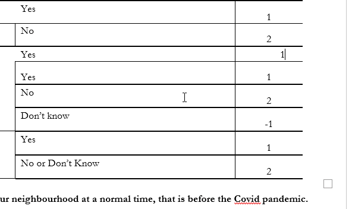{fig-alt="Animation of a Word table listing survey answers (Yes, No, Don't know) beside their numeric codes. After cells are deleted with 'Shift cells up', the answer labels incorrectly move up a row so they no longer sit beside the right codes."}

What is especially great about Markdown is the text and its 'markup' is separate to how it looks when 'knitted'. You do not have to worry about messing up the formatting when writing and editing - you can focus solely on the text and code. When you do knit, everything is then converted to your selected file format with neat and consistent formatting. You don't have to check that the text size is consistent across paragraphs or any such of the usual nonsense experienced with Word.

There are default themes / templates that are used when knitting that determine the fonts, font size, etc. However, you can swap these out if you want. For example, there are a range of [built-in HTML themes](https://rpubs.com/ranydc/rmarkdown_themes). Other themes/templates can be installed as packages or found online and downloaded. It's also possible to pass other arguments to customise the formatting or even write your own themes and templates. Given the wonders of open-source - you can also find a theme/template you like and modify it, or even pick and mix elements from different themes and templates.

With Markdown, you can also setup a single Markdown file to be knitted to HTML, PDF, and Word - including light/dark versions of HTML and regular and large print versions of PDF and Word. If you later need to make an edit to the text, you just edit the single Markdown file and click 'knit' and that's it - all versions of the HTML, PDF, and Word files are updated to match.

You can see more of what is possible in the [R Markdown gallery](https://rmarkdown.rstudio.com/gallery.html). And that is but a fraction of what is possible with R Markdown...
:::

### The parts of an R Markdown file {#parts}

An R Markdown file has three main kinds of content:

- The [YAML header](#yaml) at the very top, enclosed by the dashes `---`.
- Regular text with Markdown syntax for any formatting.
- [Code chunks](code-chunks.qmd#parts), each starting with ```` ```{r optional-name} ```` and ending with ```` ``` ````.

This means, you can write narrative text around the code chunks to record any notes and interpretation, with headers to structure it into sections.

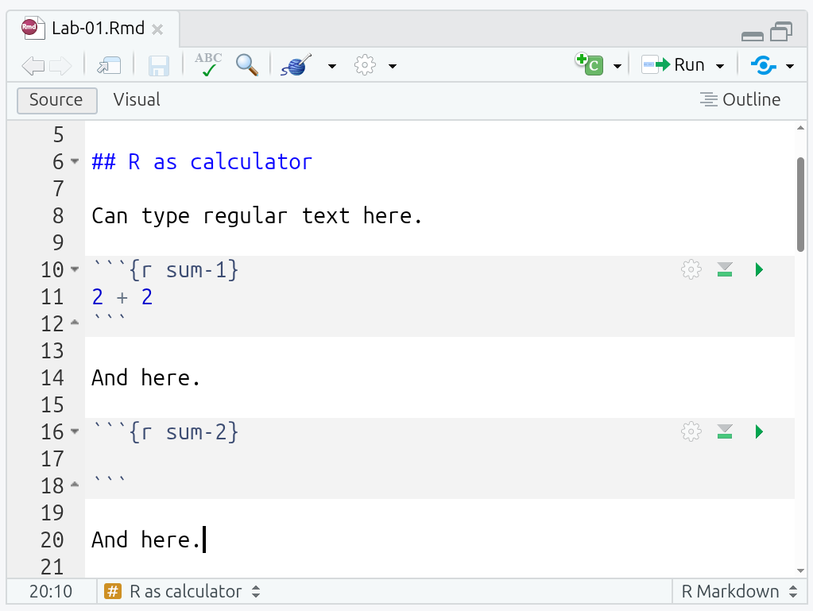{fig-alt="An R Markdown file with a level 2 heading 'R as calculator', lines of plain text reading 'Can type regular text here.' and 'And here.', and two code chunks named sum-1 and sum-2 shaded grey between them."}

## Creating an R Markdown file {#creating}

There are two main ways to create an R Markdown file in RStudio, and they give you slightly different files.

After creating a new markdown file, RStudio may display a yellow banner at the top of the file asking to install some packages (the `rmarkdown` package and the additional packages it needs): click 'Yes'. (Don't worry if this doesn't show: if the packages are already installed, there is nothing for RStudio to ask).

### From the File menu {#file-menu}

From the menu bar at the top of RStudio, select `File > New File > R Markdown...`.

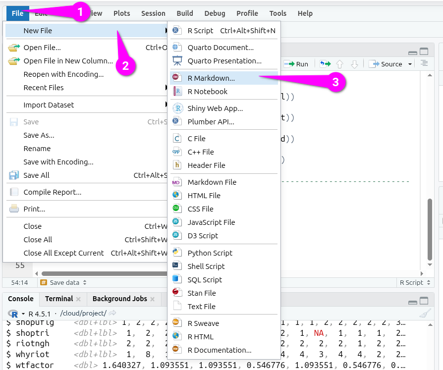{fig-alt="RStudio's File menu open, with New File selected and its submenu listing R Script, Quarto Document, R Markdown and other file types. Numbered arrows point to 1. File, 2. New File and 3. R Markdown."}

1. From the top menu-bar select 'File'.
2. In the File menu, select the first item 'New File'.
3. In the New File sub-menu, select 'R Markdown...'.

A 'New R Markdown' dialogue window will open. Type a title in the 'Title' section and your name in the 'Author' box. (Optionally) tick the checkbox for 'Use current date when rendering document'. The 'Default Output Format' as `HTML` is fine for what we cover on the module. Then, click 'OK'.

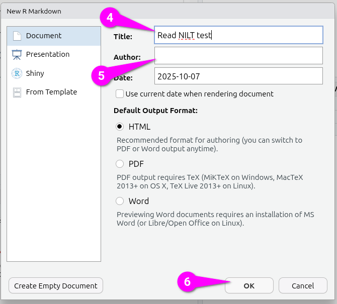{fig-alt="The New R Markdown dialogue with boxes for Title, Author and Date, a checkbox for 'Use current date when rendering document', and Default Output Format options. Numbered arrows point to 4. Title, 5. Author and 6. OK."}

**Important**. After creating the new file is not actually saved yet. Save it with `File > Save As...`, and give it a name. RStudio will auto-add `.Rmd` to the end.

When creating a new R Markdown file via the `File` menu, it includes some template content by default: a YAML header with the title, name of the author, date, and the type of output; a code chunk named "setup"; and, some example text and code chunks going over the basics of R Markdown.

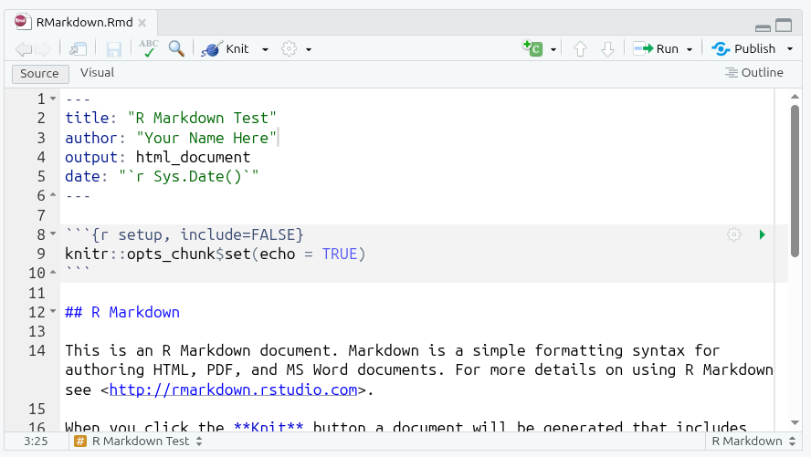{fig-alt="A new R Markdown file in RStudio's Source pane: a YAML header with title, author, output html_document and a date line with inline R code; a setup code chunk; then a level 2 heading 'R Markdown' and the start of the example text."}

The example content is useful to look at once (the setup chunk is explained on the [Code chunks](code-chunks.qmd#setup-chunk) page), but you will usually delete everything below the setup chunk before starting your own work.

### From the Files pane {#files-pane}

Within the Files pane (in the bottom-right section in RStudio):

1. Click 'New File'.
2. From the list of options select 'R Markdown'.

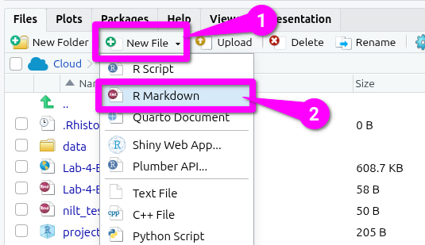{fig-alt="RStudio's Files pane with the New File drop-down open. Numbered boxes highlight New File and R Markdown."}

Within the 'Create a New File in Current Directory' dialogue that pops up:

3. Give the file an appropriate name, such as `exploratory-analysis.Rmd`.
4. Click 'OK'.

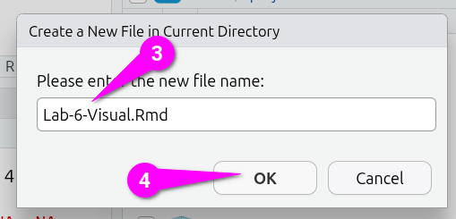{fig-alt="A small dialogue titled 'Create a New File in Current Directory' asking 'Please enter the new file name:', with Lab-6-Visual.Rmd typed in the box. Numbered pink markers point to the box and to the OK button."}

The R Markdown file will automatically open in the Source pane (top-left). It just contains basic YAML for title and output, which is HTML by default, and by default the title is just the name given to the file. Feel free to then flesh out the YAML header, such as adding a more full descriptive title and your name as the author (see [The YAML header](#yaml)).

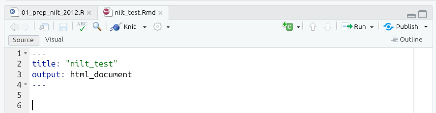{fig-alt="A new R Markdown file in RStudio containing only a YAML header with the title 'nilt_test' and output html_document."}

::: {.callout-important}
The new file created will be added to whichever folder is currently active within the Files pane. So, before you click 'New File', check you are in the folder you want to add the file to. For example, the main top-level folder for your project not a subfolder.
:::

## Writing text: Markdown syntax {#markdown}

R Markdown uses simple, human-readable syntax for basic formatting. Whilst different to how you would write text in a Word document, it is easy to learn. (The R Markdown cheat sheet, available from RStudio via `Help > Cheat Sheets` also gives a single-page summary of the syntax.)

### Headings {#headings}

Headings are created by using the pound / hash sign, `#`, at the start of a line, with the number of hashes determining the header level:

```markdown
# Heading 1

## Heading 2

### Heading 3

#### Heading 4

##### Heading 5

###### Heading 6
```

And, how it appears when knitted:

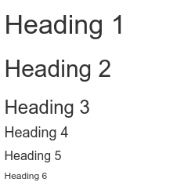{fig-alt="Six headings when knitted, from Heading 1 in the largest text down to Heading 6 in the smallest."}

### Bold, italics, and lists {#formatting}

Basic formatting and lists similarly use simple 'markup' such as `*` and `-`:

```markdown
Single asterisks creates *italicised* and double asterisks
creates **bold** text.

- Dashes `-` create lists.
  - Add spaces at start of line before the dash.
  - To create indented lists.

1. Adding numbers at the start.
2. Will create a numbered list.
```

And, this is how it appears when knitted:

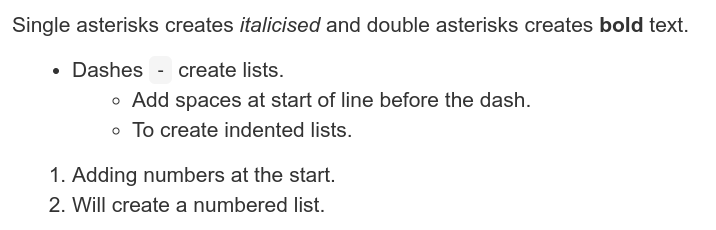{fig-alt="The knitted text: 'italicised' in italics and 'bold' in bold, a bulleted list with two indented sub-items, and a numbered list with two items."}

### Blank lines between paragraphs, lists and headers {#line-spacing}

The main thing in R Markdown's syntax that trips up new users is the requirement to have empty line spaces between:

- Each paragraph
- Before and after a list
- Before and after a header
- Before and after a code chunk

Here's some example text in an R Markdown document, the first without line spacing, the second with:

```markdown
When knitted the below text
# will not appear as a header
because there is no line spacing

When knitted the below text

# will appear as a header

because there is line spacing
```

And, how this looks when knitted:

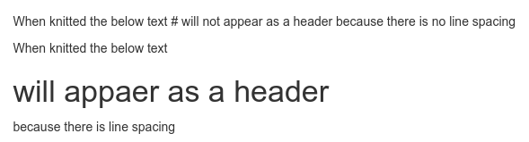{fig-alt="The knitted result. The first block runs together as one paragraph with a literal # in the middle of it. In the second, the # line has become a large header."}

::: {.callout-note collapse="true" title="Aside: where the empty lines come from"}
This practice of using empty line spaces originates from traditional coding conventions. To make code readable, a common coding convention is to place a specified limit on the number of characters per line, with any text beyond that number placed on a new line. Whilst that works OK for code, it creates an issue for text as we now need to distinguish a new line used simply to keep the number of characters per line to a set number and a new line meant to designate a new paragraph, start of a list, and similar. The solution decided upon is to have an empty line.

Additional aside: If you have encountered Markdown in other software, you may have come across exceptions to this convention. Some contemporary apps that are focused more on writing than coding do away with the need for empty lines before lists and other elements, adding to the confusion when using R Markdown for the first time when empty lines are required.
:::

### Why `#` is a header outside a code chunk but a comment inside one {#hash}

````markdown
# Data Cleaning

## Coercing the age variable

```{{r coerce-age}}
# age is read in as text, so need to transform the variable to numeric
police <- police |> mutate(age = as.numeric(age))
```
````

In the above we can see how:

- Outside a code chunk, `#` creates a level 1 header and `##` creates a level 2 header.
- Inside the code chunk, the `#` creates a comment.

Any text within an R code chunk after a `#` is treated as a comment and is not run as part of the code (see [Comments](r-syntax.qmd#comments) on the R syntax page).

You may be wondering why the same character gets used in two different ways. The reason is that R and Markdown developed separately to each other. By the time R Markdown was created to bring the two together, they both had already decided to use `#` for different things. Inside of a code chunk, all text is treated as code for the language specified in the curly brackets, e.g. ```` ```{r} ````. In R, hash signs are used for comments, so they are treated as comments when inside the code chunk rather than as Markdown headers. Whilst confusing at first, it all boils down to "# inside code chunk = comments" and "# outside code chunks = headers".

So if you want a new section in your document, the heading goes in the regular text, not in a code chunk: a line such as `## Categorical analysis` typed inside a chunk is just a comment, and no heading will display in the knitted file.

## The YAML header {#yaml}

The part at the top of an R Markdown file enclosed by the dashes `---` is called `YAML`. YAML is a simple human-readable markup language for data serialisation, often used with Markdown as it provides a simple human-readable structure for adding metadata, such as the document title, author, date, and desired output when knitting. It consists of what are referred to as `key: value` pairs.

The YAML block must be at the **very top** of the document, so do not add any new lines before it. Two common issues for beginners is either (1) accidentally adding new lines before the YAML header or (2) accidentally deleting the opening or closing `---` that enclose the YAML header.

```yaml {filename="Template"}
---
title: "TITLE"
author: "YOUR_NAME"
date: "`r format(Sys.time(), '%d/%m/%y')`"
output: html_document
---
```

- `title` is self-explanatory, simply replace `TITLE` with the title of the document you are working on.
- `author` again simply replace `YOUR_NAME` with your name.
- `date` can be any text. However, `format(Sys.time(), '%d/%m/%y')`is a nice single line of R code that runs when the file is knitted to retrieve the current date and formats it as dd/mm/yy, such as 04/12/26. This then effectively makes the `date` field "date this file was knitted" and saves you having to manually update it each time (see [An automatic date](#yaml-date)).
- `output` specifies what file format(s) to output to when knitting the R Markdown file.

Whilst quotation marks - `"` - are not always needed for text fields like title, author, and date, but it is always best practice to include i anyway. For example, `title: some title` would work without quotation marks, but `title: some title: and its subtitle` would not due to confusion over the additional `:`. With quotation marks though, `title: "some title: and its subtitle"` would work as the `"` makes clear the second `:` is part of the title text. Note though that `html_document` is not 'text' - as in text to display - but an 'option' so it never has quotation marks around it.

In RStudio it looks like this:

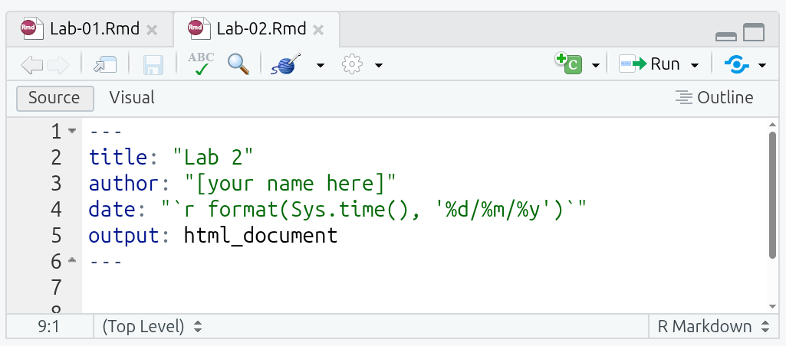{fig-alt="The top of an R Markdown file in RStudio showing a YAML header between two lines of three dashes, with title 'Lab 2', author '[your name here]', a date line using format(Sys.time()) in inline R code, and output html_document."}

### An automatic date {#yaml-date}

The date line in the YAML header above used [inline code](#inline-code) by exclosing code inside ``` `r``` and a closing ``` ` ```.

This meant we could include the following code to automatically get today's date each time we knit the document:

```{r}
#| eval: false

format(Sys.time(), '%d/%m/%y')
```

- The `format()` function takes an object as its first argument and then one or more further arguments to specify how it should be formatted.
- The `Sys.time()` function checks the date and time on the device and creates a 'date time object' (basically an R object which stores a date and time) with the current date and time.
- Our last bit of code then, `'%d/%m/%y'`, specifies the format the date time object should be displayed in. The `%` followed by a letter specifies which date/time info to include, and how to format it, from our date time object: `%d` the day, `%m` the month and `%y` the year as two digits. For the year in four digits, such as 2026, use `%Y` instead.

::: {.callout-note collapse="true" title="Aside, why we need `format()`"}
If you run `Sys.time()` in the Console, you will see the date is formatted Year-Month-Day:

```{r}
Sys.time()
```

This is common in computing as if you have a list of dates and sort them this will work, whereas if it was Day-Month-Year it would put 1st October before 5th May because 1 comes before 5.

`format()` then let's us transform how the date is displayed to order people are more used to:

```{r}
format(Sys.time(), '%d/%m/%y')
```

You can run `help(format.POSIXct)` in the Console and scroll down a bit in the help page to see what other `%` options are available. (`POSIXct` is just the class type of the date time object we created, with 'ct' standing for calendar time.)
:::

### Options for HTML documents {#html-options}

We can do a lot with the YAML header. A nested list of additional key-value pairs under `html_document:` can be used to specify some options for how we want a knitted HTML document to look:

```yaml
---
title: "R Markdown Test"
subtitle: "This is a test"
author: "Your Name Here"
output:
  html_document:
    toc: true
    toc_float: true
    theme: cosmo
date: "`r Sys.Date()`"
---
```

- `html_document` goes on its own line under `output:`, with a 2-space indent at the start and a `:` at the end. (In RStudio, placing your cursor at the start of `html_document` and hitting enter should auto-add the 2-space indent for you.)
- The options for the HTML document go on the lines under it, each now with a 4-space indent to make clear these are key-value pairs related to `html_document:`.
- `toc` stands for "table of contents" and is `false` by default.
- `toc_float` places the table of contents as a floating element on the left-hand side of the document rather than as fixed text at the top of the document.
- `theme` changes the default HTML template used to the "cosmo" theme instead.
- `date:` as it is a main option - and not a sub-option of `output:` nor `html_document:` - appears at start of a new line with no indent.

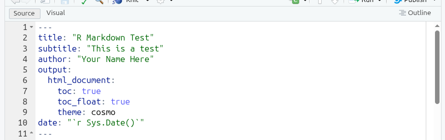{fig-alt="The same YAML header in RStudio's editor: title, subtitle and author lines, then output: with html_document: indented beneath it and toc: true, toc_float: true and theme: cosmo indented further."}

The knitted document would contain the main title, subtitle, followed by your name and the current date, as specified in the YAML. A table of contents appears on the left, showing the headers used in the document, with the header for the section currently in view on the screen highlighted in blue (notice how it changes if you scroll up/down the HTML file).

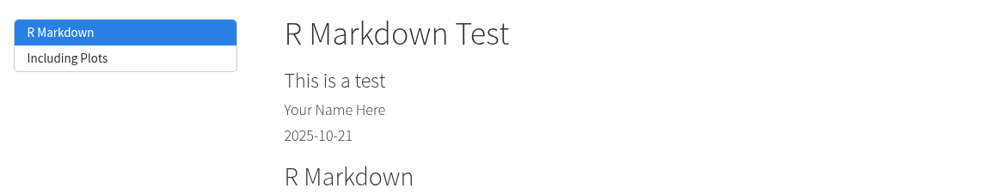{fig-alt="The top of a knitted HTML document: a table of contents box on the left listing 'R Markdown' (highlighted) and 'Including Plots', and on the right the title 'R Markdown Test', the subtitle 'This is a test', the author 'Your Name Here' and the date 2025-10-21."}

This is another powerful aspect of using R Markdown. Your document itself remains fairly simple, but with a few simple options you can quickly customise its look and add features like a table of contents. There are a lot more [options you can use with HTML documents](https://bookdown.org/yihui/rmarkdown/html-document.html) and a range of [themes you can choose from](https://rpubs.com/ranydc/rmarkdown_themes).

## Knitting {#knitting}

Knitting a document runs all your R code from top to bottom, then combines the results from this with the Markdown text to convert these into different file formats. YAML is used to specify which file formats to convert to. To render the document from R Markdown to HTML, click on the 'Knit' button at the top of the file (or press ).

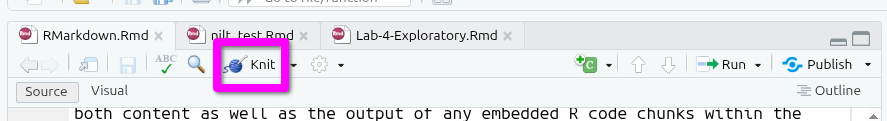{fig-alt="The toolbar at the top of an R Markdown file in RStudio, with the Knit button (a ball of wool with a needle) highlighted by a pink box."}

The first time you knit, and if you have not done so already, RStudio may ask you if you want to install or update some packages: click 'Yes'. After you knit the document, a window with the output will pop up automatically. You can come back to the R Markdown file to make changes and knit it again as many times as you wish. Importantly though, knitting is not automatic: each time you change the R Markdown file you will need to 'knit' it again for the changes to be reflected in the HTML file.

### The knitted HTML file {#knitted-file}

When you knit a document as a HTML file, RStudio actually creates a new `.html` file with the same name as your R Markdown document, in the same folder. You can confirm this by looking in the 'Files' tab in the bottom-right.

{fig-alt="RStudio's Files pane listing a project's files, with RMarkdown.Rmd and RMarkdown.html next to each other highlighted by a pink box."}

To open the knitted file again later, click its name in the Files pane and choose 'View in Web Browser'.

### The Knit menu: HTML, PDF and Word {#knit-menu}

The small arrow beside the Knit button opens a menu with 'Knit to HTML', 'Knit to PDF' and 'Knit to Word'.

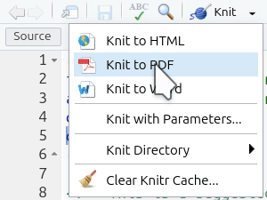{fig-alt="The Knit button's drop-down menu open, listing Knit to HTML, Knit to PDF, Knit to Word, etc."}

Choosing one of these also adds it to the `output:` line of your YAML header. Say you select PDF, `pdf_document` will be added to `output:` in the YAML header. Now every time that you knit, an HTML file **and** a PDF file will be created. That's fine if that is what you intended, but can come as a surprise if not.

Importantly, this behaviour can result in unexpected issues if you are using a package whose output does not work nicely with your chosen format. Some R table packages, for example, require additional setup if wanting to knit to PDF. It is surprisingly easy to accidentally click 'Knit to PDF' and have `pdf_document` added to the YAML header, resulting in a file that used to knit without issue not failing to knit. To fix such issues, all you need to do is remove the `pdf_document` line from the YAML header.

### Knitting starts from a clean R session {#fresh-session}

**Importantly**, when you knit an R Markdown document, all code is run sequentially from top to bottom in a **fresh** R session - in other words, it starts with a blank Global Environment. This ensures the document is reproducible. Anyone with a copy of the R Markdown file and the data being used should be able to knit it and receive the exact same results.

This requires though that all essential code for your analysis is within code chunks *and* in the correct order that they need to be run in. For example, if you run `d <- 25` manually in the **Console** and then add `d + 5` in a code chunk, that code chunk will work fine when manually run in RStudio, but will result in an "object not found" error if you try to knit. This is because `d <- 25` also needs to be in a code chunk before the `d + 5` code within the R Markdown file as the clean Global Environment used to knit will not have an object called `d`.

The same applies to packages and data. Whilst knitting can access packages that are installed on the computer, it has no packages loaded nor data frames read in. Even data frames sitting in your Global Environment (the top-right pane) from earlier work are not available to clean Global Environment used when knitting a file. This is why it is important to include a code chunk at the top of your document that loads all required packages and reads in your data.

## Knitting Errors {#knit-errors}

### An object or function not found {#not-found}

If you receive an `object '...' not found` error when knitting, for an object you can see in your Environment pane, it is likely the code that creates it was run in the Console, or in a chunk you have since changed or deleted, rather than in the file (see [Knitting starts from a clean R session](#fresh-session) above). Likewise, if you receive `could not find function "..."`, it is likely the package the function comes is not loaded in a code chunk within the file:

```
Error in `read_csv()`:
! could not find function "read_csv"

Quitting from analysis.Rmd:6-8 [preamble]
Execution halted
```

The "Quitting from" line gives the file, the lines of the code chunk (here lines 6-8) and, in square brackets, the chunk's label (`preamble`). A chunk without a label is listed as `unnamed-chunk-1`, `unnamed-chunk-2` and so on, which is one reason labels are worth adding (see [Chunk labels](code-chunks.qmd#labels)).

The solution for the above would be to add the missing code that would load the package which provides the `read_csv()` function - e.g. `library(tidyverse)` - in a code chunk before `read_csv()` is first used.

### PDF in the output {#pdf-output}

A common cause of knitting issues is accidentally adding PDF as a file format to output when knitting. If receiving a "package '...' could not be loaded" error message, check the YAML header at the top of your R Markdown file. Some R table packages require additional code when knitting to PDF, without which your file will fail to knit with vague error messages.

You should have either of the following for `output: ...`:

```yaml {filename="Either"}
output: html_document
```

```yaml {filename="Or"}
output:
  html_document:
    ...
```

But, will probably have something like the following if receiving the error message:

```yaml
output:
  pdf_document: default
  html_document: default
```

This can happen unintentionally as RStudio can automatically add a line for PDF output, such as if you accidentally clicked 'Knit to PDF' in the [Knit menu](#knit-menu). Annoyingly, even if you click 'Knit to HTML' from the options, if your YAML header includes `pdf_document` in its outputs, R will still try to create a PDF document and keep running into the error message.

So, if you are receiving the error message and have the two output lines, you can easily fix it by removing the `pdf_document` line. As the YAML header then specifies an HTML output, you can just click the 'Knit' button directly each time rather than clicking the wee down arrow to select 'Knit to HTML' specifically.

### The file is in the wrong folder {#wrong-folder}

If code that reads your data works in one R Markdown file but gives an error in another, the most likely cause is that the second file was created in a subfolder, rather than the top-level project folder.

{fig-alt="RStudio's Files pane with the folder path 'Cloud > project > data' highlighted, and 'project' boxed in pink. The folder lists nilt_r_object.rds and nilt2012.sav."}

The reason is that an R Markdown file runs its code from its own folder. Code like `read_csv("data/police_killings.csv")` looks for a `data` folder inside the folder the `.Rmd` is in. So if our R Markdown file was accidentally saved in the `data` subfolder, R looks for our csv file at `data/data/police_killings.csv`, which does not exist:

```
Error:
! 'data/police_killings.csv' does not exist in current working
  directory:
  '.../project/data'.
```

The fix is to move the R Markdown file up to the top-level project folder (see [Moving files](rstudio.qmd#moving-files) on the RStudio page). File paths and the working directory are explained on the [Base R](base-r.qmd#files) page.

### Two chunks with the same label {#duplicate-labels}

Chunk labels are optional, but each label can only be used once in a file. It is easy to end up with two when copying and tweaking an existing chunk, such as a second `setup` chunk copied with its label, and this stops the knit before any code runs:

```
Error in parse_block(g[-1], g[1], params.src, markdown_mode) :
  Duplicate chunk label 'setup', which has been used for the chunk:
knitr::opts_chunk$set(echo = TRUE)
Calls: <Anonymous> ... process_file -> split_file -> lapply -> FUN -> parse_block
Execution halted
```

Despite the confusing error message, the solution is simple: rename or delete the label for one of the code chunks and the file will knit again.
