## What RStudio is {#what-rstudio-is}

### R and RStudio {#r-and-rstudio}

`R`
:   a programming language and environment for data analysis.

`RStudio`
:   a user-interface for working with R.

`R` and `RStudio` are two separate things. In short, most of the time in practice you chiefly use RStudio whilst `R` is doing all the work in the background. RStudio is what is known as an 'integrated development environment', which is just a technical way of saying that it makes it easier to write and run R code, manage files, view outputs, and so on within a (somewhat) user-friendly interface.

Emphasis obviously on the 'somewhat'. Whilst RStudio does make it 'easier' to work with R, it can still feel overwhelming at first.R strictly speaking is merely the programming language. It comes bundled with a 'command line console' that interprets and runs the code. Within RStudio this R console runs in the Console pane on the bottom-left. If you opened plain R on your desktop the content of that Console pane is all you would see.

RStudio then is adding a lot of things around R to make it easier to work with. Importantly, whilst it presents you will a vast array of panes, tabs, and buttons - which adds to sense of overwhelm - you do not need to know what every single one of these does. Just like in Word or Google Docs where you rarely use most of its features, the same is true of RStudio. RStudio is also showing its age a bit that adds to the overwhelm. Once you adjust though to how it works and where to find things it is not as complex as it initially feels.

### Installing R and RStudio Desktop {#installing}

There are multiple ways to work with R. One, and by far the most common, is to download both `R` and RStudio Desktop and install the applications on your local device.

Install R first, from [CRAN](https://cran.r-project.org/) (choose the download for Linux, macOS, or Windows based on the operating system your device uses), and then RStudio Desktop, from [Posit's download page](https://posit.co/download/rstudio-desktop/).

After you have both installed you only ever need to open RStudio.

::: {.callout-note collapse="true" title="Aside: Alternatives to RStudio"}
If you have prior experience working with other programming languages you may have used software such as Visual Studio Code. Both RStudio and Visual Studio Code are 'intergrated development environments'. We use RStudio as it designed specifically for working with R, the most established IDE for working with R, and the one that most textbooks and online resources will assume you are using.

So, do not worry about other software options if you have never used them before. One of the benefits of open-source software is that you often have a range of different tools you can pick and choose from. For beginners though that can just add to the overwhelm - which is again why RStudio is your best option if coding is general is entirely new for you.

However, if you have used something like Visual Studio Code before and prefer how it looks and works over RStudio, you might want to take a look at [Positron](https://positron.posit.co/).

Positron is built ontop of the core components of Visual Studio Code - but, crucially, set up to have a similar panel layout as within RStudio which makes it better for working with R over regular Visual Studio Code.
:::

## The RStudio screen {#panes}

Your RStudio screen is split in four **important** windows or panes:

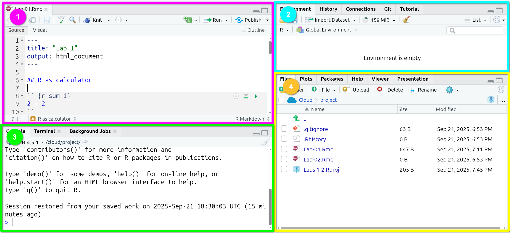{fig-alt="The RStudio window divided into four boxed and numbered panes: an R Markdown file in the top-left, the empty Environment pane in the top-right, the Console in the bottom-left, and the Files tab in the bottom-right listing the files in a project folder."}

- **Pane 1**, top-left: the Source pane, where your R Markdown files and R scripts are displayed in tabs when opened. This is the area where you will be working most of the time. From here, you will write text and code.
  - Note, if you are opening RStudio for the first time or created a new project this pane might not be displayed at first. Instead the whole of the left of the screen will be taken up by **Pane 3**. **Pane 1** though will show once you create / open a file.
- **Pane 2**, top-right: the Environments, and its default 'Environment' tab is one of the most useful tabs in this pane, which shows you the active 'objects' that you have available/loaded in your current R session.
- **Pane 3**, bottom-left: the R Console. This is where you will see most of the results of the code you run.
- **Pane 4**, bottom-right: multiple useful tabs, including Files, Plots, Packages, Help and Viewer.

Whilst it may look intimidating at first, with all of its panes and tabs, once you get used to it you will find this layout supports quickly moving between different tasks.

### Source pane {#source-pane}

The top-left is where 'Sources', such as R scripts and R Markdown files, are opened. To open an existing file, click it in the Files tab in the bottom-right pane.

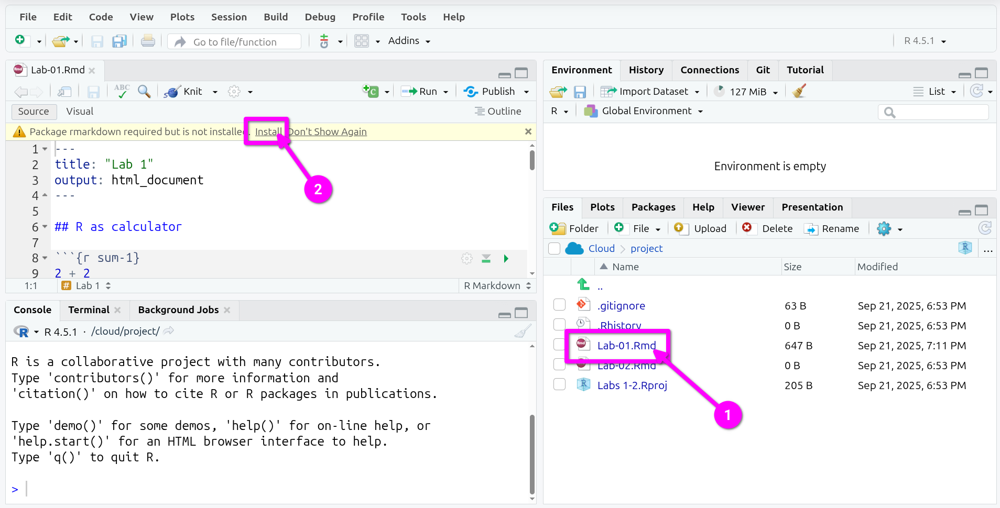{fig-alt="The whole RStudio window with its menu bar. In the Files tab a file named Lab-01.Rmd is marked 1; it is open in the Source pane, where a yellow banner reads 'Package rmarkdown required but is not installed. Install. Don't Show Again', with Install marked 2."}

Importantly, if you are creating or opening an R Markdown file for the first time you will also see a yellow banner at the top of the Source pane. In order to 'knit' R Markdown files you need  to have other R packages installed. So this banner is there just to let you know you still need to install those packages - where you can click 'Install' to do so. (If you previously clicked "Don't Show Again" you can simply run `install.packages("rmarkdown")` in the Console.)

Note that you can have multiple files open in the Source pane at the same time. These will appear as a series of tabs along the top of the Source pane. If what you were working on unexpectedly changes, make sure you haven't accidentally switched tabs to anoother file.

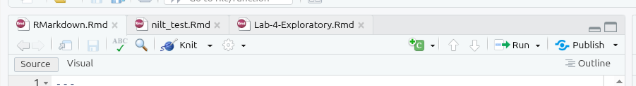{fig-alt="The top of the Source pane with three tabs: RMarkdown.Rmd, nilt_test.Rmd and Lab-4-Exploratory.Rmd, above the toolbar with Knit, Run and Publish buttons and the Source and Visual toggle."}

The toolbar along the top of the Source pane changes with the type of file open: an R Markdown file has a Knit button (see [Knitting](r-markdown.qmd#knitting)). So if you cannot see the Knit button, the file you currently have open might not be an R Markdown file. You will know it is an R Markdown file as the file-name will have `.Rmd` at the end of it.

### Console {#console}

The R Console is placed in the bottom-left pane. You can write and run code here, by typing the code and hitting :

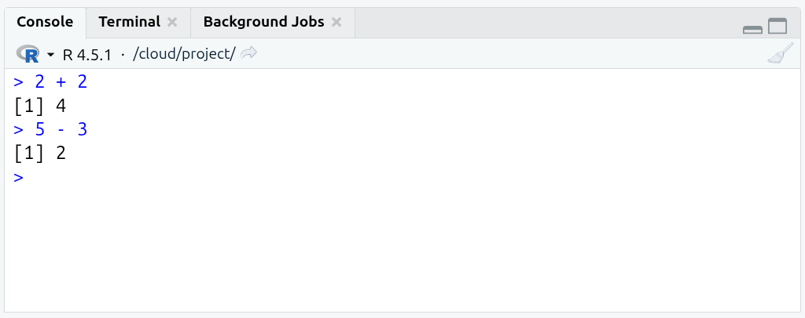{fig-alt="The Console pane showing '> 2 + 2' followed by '[1] 4', then '> 5 - 3' followed by '[1] 2', and an empty '>' prompt."}

When you run a script, R Markdown file, or individual code chunks, the lines of code they contain are sent by RStudio to the Console. So, you see the code echoed and its raw output there. RStudio will then, as appropriate, add outputs from the Console below code chunks or display them in the bottom-right Viewer pane. Graphs and formatted tables cannot be viewed in the Console (see [Plots pane](#plots-pane) and [Viewer pane](#viewer-pane) for where they show).

Sometimes you will want to type code directly in the Console, such as when installing packages or running quick checks with code you do not want to make a permanent part of your R Markdown file. (More on when and why to use the Console rather than a file is covered under [The Console or a file?](#console-or-file).)

After typing in code and hitting enter to run it, you will not be able to enter more code until it finishes running. Pending on what the code does it can seem to run almost instantenously or for seconds, minutes, or longer. You will know when you can type more code again as the final line in the Console with be a `>` prompt symbol.

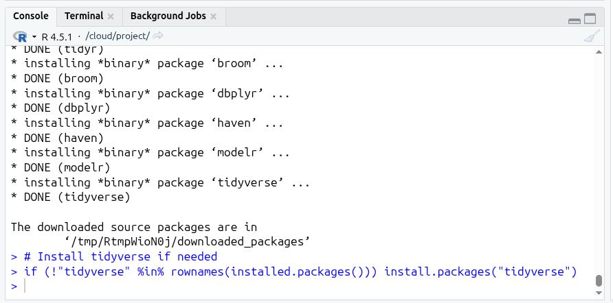{fig-alt="The Console pane: the last lines of a tidyverse install ('installing binary package tidyverse ... DONE'), then a comment and an if line beginning with '>', showing code sent from a script, and an empty '>' prompt."}

If the `>` prompt at the start of the Console's last line changes to `+`, see [the `>` and `+` prompts](r-syntax.qmd#prompts).

If you ever run code that you want to cancel, you can press  in the Console to stop it.

### Environment pane {#environment-pane}

The top-right pane includes the main R environment. The environment is the work space where all data and functions you create are stored during a session. When code that reads in a dataset is run, it stores the read dataset as a data frame object in the environment.

Say we ran the following code:

```{r}
#| eval: false

a <- 10
c <- 3
```

This creates two objects. An object named `a` with the value of `10` and another object named `c` with a value of `3`. You'll know such code has run OK if you can see the data frame in the Environment pane.

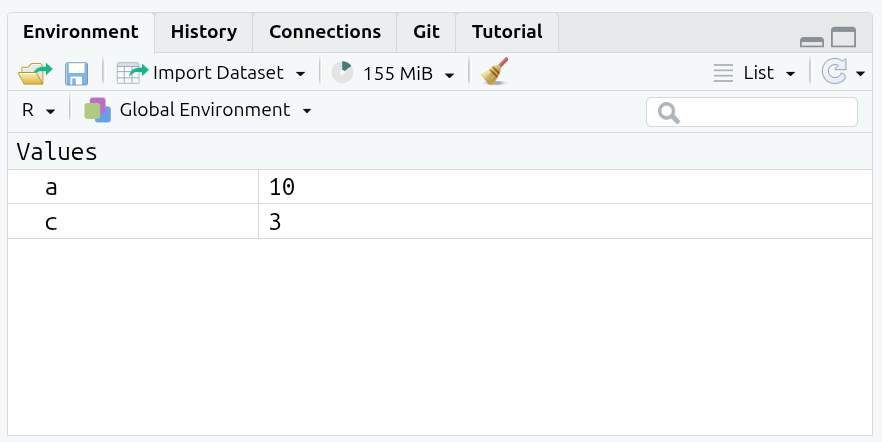

The same is true for all objects that we create with the code we run. For example, if we were working with the [police killings dataset](https://github.com/fivethirtyeight/data/tree/master/police-killings), we could read it in and assign it to an object called `police`. The object `police` will then be listed under Data with its 467 observations (i.e. its rows) and 34 variables (i.e. its columns).

{fig-alt="The Environment pane under the heading Data, listing police with 467 obs. of 34 variables and starwars2 with 87 obs. of 11 variables, each with a blue expand arrow on the left and a table icon on the right."}

The broom icon in the Environment pane's toolbar clears all objects from the environment, leaving it empty. This can be useful if you've created a whole bunch of objects and want to remove them all.

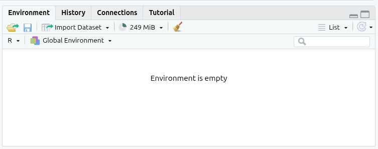{fig-alt="The Environment pane showing 'Environment is empty', with the broom icon in its toolbar beside the memory usage."}

Note, whilst this removes objects, it does not remove any loaded libraries (see [Clearing the environment](base-r.qmd#clearing) on the Base R page); for a completely fresh start, see [Restarting R](#restarting-r).

### Viewing a data frame {#data-viewer}

If you double-click on a data frame in the Environment pane, you can open it up in a new tab like an Excel sheet. If you look in the Environment pane, you will also see a small faded table icon at the far right of the row for the dataframe. Clicking it does the same as double-clicking its name. Similarly, if we had read in our data as a named object called `survey_data` we could run in the Console `View(survey_data)` to also open this tab.

(In general, you will find there are 3+ different ways to do the same thing. This can seem confusing when first learning how to use RStudio, but as you get more experience using RStudio you will find some options more convinient than others pending on your workflow and preferences.)

So say we were working with data from the NILT 2012 survey and loaded it in as an object named `nilt`. If you used one of the above options to view this object we would see something similar to the below:

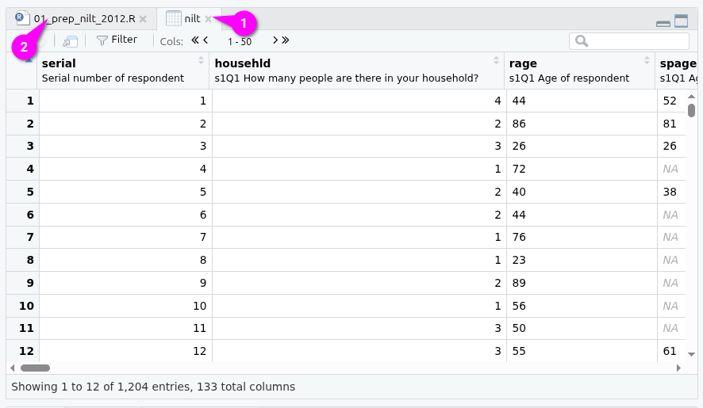{fig-alt="The data viewer tab for the nilt data frame: columns serial, househld, rage and spage, each with its variable label in small text under the name, NA values in grey italics, a Filter button, a 'Cols: 1 - 50' control, and 'Showing 1 to 12 of 1,204 entries, 133 total columns' at the bottom."}

You can scroll down or along your columns in a table-style format, and you can sort the contents of the variables by clicking on the header. But note that you cannot make any changes from here. Once you have finished checking your data, you can get back to your file by either (1) clicking the small 'x' to close the tab showing the data frame or (2) clicking on the tab with the name for the file you were working in.

This gives a nice visual way to get overview of your data, but for many things it remains better to use code. (See `glimpse()` on the [tidyverse](tidyverse.qmd#glimpse) page, and [why exploring with code soon becomes quicker](learning-to-code.qmd#worth-it)).

### Files pane {#files-pane}

In the Files tab (bottom-right) you can see the files and folders that you have in your project. Click a file to open it in the Source pane. You can also click a folder's name to go into that folder within the Files tab. (Note, you need to click the name and not the folder icon).

It has a toolbar along the top with buttons for common actions you might want to take. For example, the folder icon with a green plus creates a new folder, opening a 'New Folder' dialog for its name:

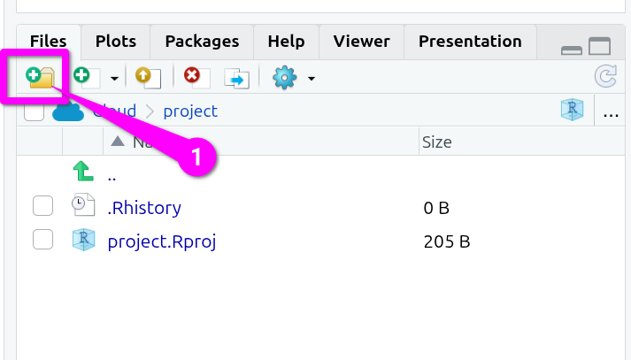{fig-alt="The Files tab toolbar with the first button, a yellow folder with a green plus, boxed and marked 1."}

The white document icon to the right of it, with its small drop-down arrow, creates a new file, such as an R Script or an R Markdown file. Importantly, if you click this it will create a new file within the folder currently being viewed within the Files tab, so if you are in a sub-folder and want to actually create a new file in the top-level folder of your project you will need to navigate back to it. You can click the `..` at the top of the list of items in a folder to navigate up.

If you click the button to create a new R script file, a 'Create a New File in Current Directory' dialog asks for the file's name, and the file then opens in the Source pane.

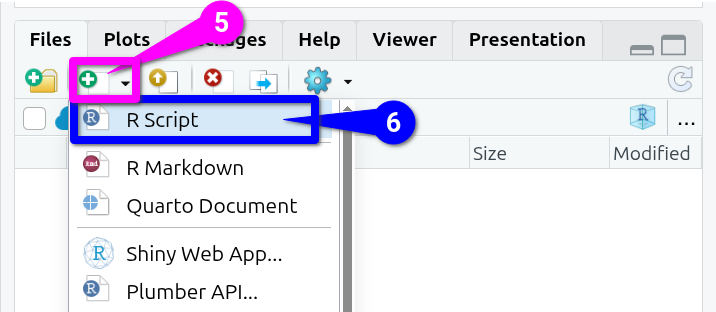

::: {.callout-note collapse="true" title="It's all just files and folders"}
The files and folders that you see in the Files tab are just ordinary files and folders stored on your computer. It is permanently displayed as it is common to work with multiple files when using R and this is easier than having to repeatedly go through multiple steps like clicking File, Open File, and then using a dialogue to navigate to the folder and file you want. (This is covered in more detail in the next section.)

It's become clear though in recent years that this pane causes a lot more issues and confusions than in the past - when it rarely needed any explaining at all. This appears to be due to mix of (1) it is a slightly old style for how to display files and folders, (2) many Microsoft, Google, and Apple apps - store files in proprietary cloud platforms by default, and (3) sadly, a lot of modern software - and especially 'apps' - hide the files and folders being used from you.

The way a lot of 'contemporary' software works is convienent, but this convenience is also part of a concerted effort by proprietary companies to obscure how your own data is stored, encourage users to pay for Cloud storage and subscription services, and/or make it more difficult to move to alternatives.

Don't worry then if you run into issues or feel confused by the Files tab - you are definitely not alone. Based on my experience teaching, the number of people each year who run into issues with it is still noticeably increasing. As with most things in RStudio though, it may be frustrating at first, but once you get used to it, you will find it is easy to work with. It is more ugly than it is complex.
:::

#### Knowing which folder you are in {#path-bar}

Near the top of the Files tab you'll see a folder path, the navigation bar, which shows the folder you are currently looking at. If you named the folder for your data analysis project `project`, you know you are in the top-level folder if it is the last item named in the folder path.

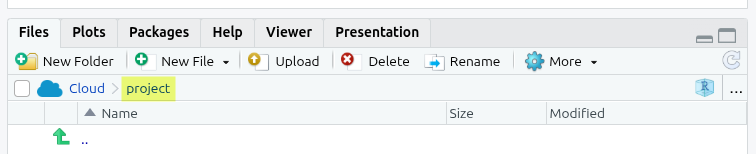{fig-alt="The Files tab's navigation bar reading 'Cloud > project', with project highlighted and nothing after it."}

If instead it shows something after it, such as "> data", you are currently in a subfolder and any new file you create will be placed in it rather than the top-level project folder. As a result, if you thought you had create the file in the top-level `project` folder but accidentally created in the `data` subfolder you will receive an error message running code like: `survey_data <- read_csv("data/survey_data.csv")` as instead of looking in "project/data" for the `survey_data.csv` it will be trying to find something in "project/data/data". (See [the file is in the wrong folder](r-markdown.qmd#wrong-folder) on the R Markdown page)

As a wee reminder, to navigate back up to the top-level folder, click *either* the '..' at the top of the folder content list or the name of the project folder in the navigation bar.

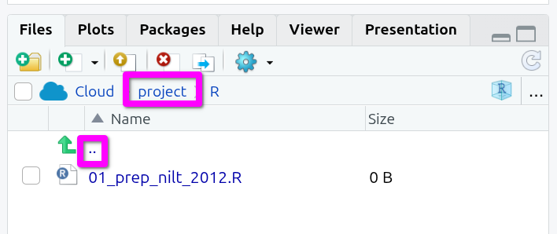{fig-alt="The Files tab inside a subfolder named R, with 'project' in the navigation bar and the '..' at the top of the file list both boxed."}

#### Moving files {#moving-files}

To move a file, such as an R Markdown file that was created in a subfolder by mistake:

1. Tick the checkbox next to it in the file list.
2. Click 'More' in the toolbar at the top of the 'Files' tab.
3. From the drop-down options select 'Move...'

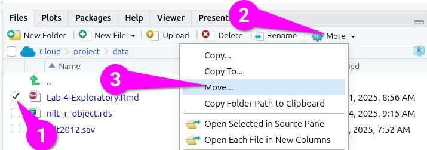{fig-alt="The Files tab inside a data subfolder with Lab-4-Exploratory.Rmd ticked (1), the More menu opened (2), and Move... highlighted (3) among Copy..., Copy To..., Copy Folder Path to Clipboard, Open Selected in Source Pane and Open Each File in New Columns."}

This will open a 'Choose Folder' dialog. Click the folder you want to move the file to, such as the top-level project folder, then click 'Choose' to confirm.

3. Click the name of the top-level folder for your project. It is called `project` here but you might have chosen a different name already.
4. Click the 'Choose' button.

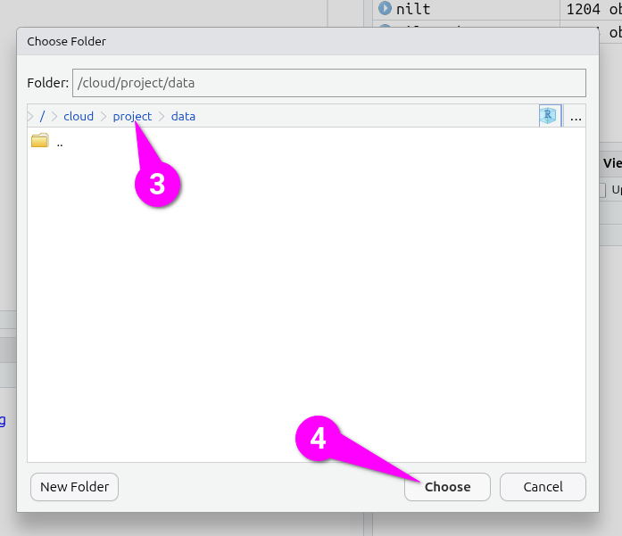{fig-alt="The Choose Folder dialog with the path cloud > project > data, the word project marked 3, and the Choose button marked 4."}

If you have the file open in a tab in the Source pane, you will be asked if you wish to close the tab now that it is moved, click 'Yes' and then re-open the file from the parent folder where you have moved it to.

### Plots tab {#plots-pane}

In the Plots tab you will see a preview of **static** (i.e. images) plots you produce using code the Console or from individual lines of code. Plots made by running a code chunk in an R Markdown file will instead appear below the chunk instead. (See [ggplot](ggplot.qmd) for more info on creating plots).

### Viewer tab {#viewer-pane}

The Viewer displays **interactive** outputs, and other web content such as some formatted tables: `sumtable()` from vtable, for example, opens its table in the Viewer when run in RStudio (see [vtable](vtable.qmd#where)). This is because it uses HTML (the coding language used to create webpages) to format its tables.

### Packages tab {#packages-pane}

In the Packages tab you have a list of the R packages that are installed on your computer.

The Install button in its toolbar opens a dialog where you type a package's name. RStudio then runs `install.packages()` in the Console for you, the same code you would type there yourself (see [installing a package](base-r.qmd#install) on the Base R page). The Update button lists the installed packages that have newer versions, for you to tick the ones to update and install them. Clicking a package's name opens the list of its help pages in the Help tab.

### Help tab {#help-pane}

The Help tab contains some resources that clarify or expand what each package and its functions do. Running `help()` or `?` with a package's or function's name in the Console opens its help page here. How to read a help page, including the default value of each argument listed under Usage, is on the R syntax page (see [finding a function's help page](r-syntax.qmd#help) and [functions and arguments](r-syntax.qmd#functions)).

## Writing and running code {#running-code}

### The Console or a file? {#console-or-file}

**Note**, it is best practice to have code necessary for your analysis saved in your R Markdown file. The Console is usually used instead to quickly run code that you do not want to store permamently in your file, such as a quick look at a data frame with `glimpse()`, a check with `class()`, or installing a package (see [installing a package](base-r.qmd#install)).

Being able to move from the Source pane (top-left) to the Console (bottom-left) and switch between 'writing code we want to save in our file' and 'writing code to quickly check our data' is another one of the reasons why RStudio has its different panes. It makes things look overwhelming at first, but provides ways to smoothly move between tasks once you build an understanding of how it works.

Any code that is needed for your analysis - such as loading packages, reading in files, coercing variables, etc - should be into your file. As code run from the Console is not part of your file, if you gave someone a copy of your file they would not be able to follow and reproduce your analysis. Similarly, if you wanted to turn your analysis into a neatly formatted HTML, PDF, or Word document by 'knitting' your R Markdown file, the knitting process will fail - as the knitting process starts from a clean environment and runs all your code in your file from top to bottom. (see [Knitting starts from a clean R session](r-markdown.qmd#fresh-session)

### R scripts {#r-scripts}

As well as R Markdown files, RStudio can open and run R scripts (`.R` files). An R script file is simply a file that contains only R code, like a giant code chunk.

Some researchers prefer using R scripts and a lot of online resources - especially those aimed at beginners - assume you are working in an R script.

As explained on the R Markdown pages though, R Markdown is useful (1) when learning R as you can add additional notes etc as you go and (2) you can 'knit' your file into neatly formatted HTML, PDF, or Word documents.

However, even when using R Markdown, there can be times where it still makes sense to also have separate R scripts. Say you have code that is used for downloading a file and doing a lot of initial data cleaning steps over dozens and dozens of lines of code. If you included this code in your R Markdown file, each time you click 'Run all Code Chunks' or 'knit' your file that file will be repeatedly - and needlessly - downloaded again and again.

In such situations, you would want to instead move that code to a separate R script that you - and importantly others who you share your files with - only need to run once. When working through lab activities and you are not repeatedly knitting your file, it can remain fine to keep things in an R Markdown file to make it easier to include notes, different examples, etc.

Where you do decide to split such code though into its own script, it is a common convention to put them in an `R` subfolder. That way all R markdown files are in the top-level folder, all data in a `data` subfolder, and all R scripts in an `R` subfolder.

To create a new R script, use the new file button in the Files tab (see [Files pane](#files-pane)) and choose 'R Script', or use File > New File > R Script from the menu bar (a script made this way is saved where you choose when you first save it).

#### A header for an R script {#script-header}

In an R script, it is good practice to include some key information at the top, such as what it does, when it was written, and who wrote it. (see the [R Markdown page](r-markdown.qmd) for good practice for structuring R Markdown files.)

Given an R script is all R code, we can add this info using comments (see [comments](r-syntax.qmd#comments) on the R syntax page):

```{r}
#| eval: false
#| filename: "Template"

## SHORT DESCRIPTION OF WHAT THE SCRIPT DOES

# Date: DATE
# Author: YOUR_NAME
```

The `##`, with an extra `#`, at the top doesn't do anything extra or different, we just include it to make visually clear this is the title / short description of what the script does.

Next, it is good practice to include details for the data set being used, especially important if the data is not our own to ensure proper attribution. In addition to being good practice, it is often a condition for data sets where it is permitted to re-share them elsewhere that you can do so only as long as you include an attribution (i.e. a reference).

```{r}
#| eval: false

# References  -----------------------------------------------------------------

# https://www.ark.ac.uk/teaching/
# 2012 Good relations: ARK. Northern Ireland Life and Times Survey Teaching Dataset 2012, Good relations [computer file]. ARK www.ark.ac.uk/nilt [distributor], March 2014.
```

#### Code sections {#code-sections}

Comments can also divide a script into sections:

```{r}
#| eval: false
#| filename: "Template"

# SECTION_NAME ----------------------------------------------------------------
```

A comment: `#`, then the name of the section (such as `References`, `Packages` or `Download and read data`), then a space and a row of at least four `-`.

The `-----` after a line such as `# References` helps make the section visually distinct. This may seem odd in a short file, but as the file grows in length, the importance of making it easy to find sections quickly from visual glance starts to make sense.

As this is a common convention, RStudio also treats any comment line that ends with at least four dashes (`----`) as a 'code section'. RStudio adds a small arrow next to its line number that folds the section away, and lists the section in the menu at the bottom left of the Source pane.

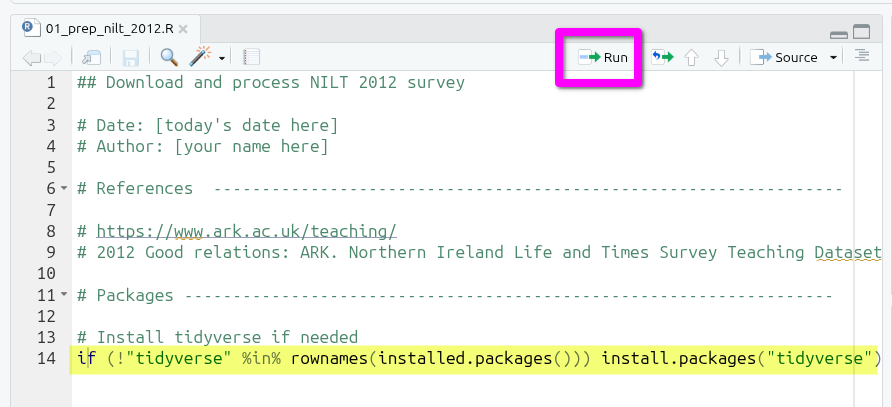{fig-alt="An R script in the Source pane: title and author comments, a '# References' line and a '# Packages' line each followed by a row of dashes and each with a small fold arrow by its line number, and line 14 highlighted. The Run button in the toolbar is boxed."}

### Running code from a file {#running-from-file}

To run a line of code from a script, put the text cursor on the line with the code and press , or click the Run button at the top of the file. To run several lines, use your mouse to select them and press  or click the Run button. After running a line in an R script, RStudio moves the cursor to the next line, so you can step through a file line by line.

The same works for single lines inside an R Markdown code chunk ('Run Selected Line(s)' in the Run button's drop-down menu). Running whole code chunks, and the other options in that menu, are on the [Code chunks](code-chunks.qmd#run-menu) page.

### Saving files {#saving}

Another small issue which more and more people new to RStudio run into is that you need to manually save all changes made to your files - whereas a lot of contemporary, and especially commerical, software auto-saves changes.

If you have made changes to a file that are not yet saved, the name of your file in its tab at the top of the Source pane will be written in red with an asterisk at the end, e.g. `analysis.Rmd*`. If it is in red, save changes by clicking on the disk icon, or with .

What can add to this confusion is RStudio does keep a backup of unsaved changes, so you can close RStudio without saves the changes and they are usually still there when you next open RStudio. However, these changes are stored in temporary files until you explicitly save the change, when they will then get written into the file proper.

If you would rather RStudio auto-saved files for you, under Tools > Global Options > Code > Saving: tick 'Automatically save when editor loses focus' and set 'When editor is idle' to 'Save and write changes'.

## Getting graphs and tables into Word {#into-word}

It is possible to knit your R Markdown file to HTML, PDF, or Word document. Although I will endlessly praise the sheer wonder and beauty of R Markdown, and the absolute and utter joyful bliss of working with it compared to the endless horrors and frustrations of Microslop Office - I do recognise that it can take time to become comfortable with R Markdown and how to get code,  outputs, and formatting to display how you want. It is also easy to have code that works perfectly fine when running individual chunks but run into unexpectedly issues when knitting with vague poorly written error messages that are hard to decipher.

**It is absolutely fine** then if you want to keep the write-up for your analysis in a Word or Google docs document (though I'd also encourage you to give [LibreOffice](https://www.libreoffice.org/) a try - it is a free and open-source Office suite) and copy across any plots and tables. There are plenty of experienced researchers who do that too.

Graphs and tables made in RStudio can be copied into your Word document with just a few clicks.

**A graph in the Plots pane** (made by code run in the Console or an R script):

1. Click 'Export' in the Plots pane's toolbar and choose 'Copy to Clipboard...'.
2. In the 'Copy Plot to Clipboard' dialog that opens, click 'Copy Plot'.
3. Paste it into your Word document.

Alternatively, choose 'Save as Image...' from the same 'Export' menu, give the image a name and save it, then insert the image file into your Word document.

**A graph under a code chunk**: a graph made by running a code chunk shows below the chunk rather than in the Plots pane. You can simply right-click the plot and choose "Copy image" or "Save image as...".

**A table in the Viewer pane**, such as one made with `sumtable()` (see [vtable](vtable.qmd)) can be exported - in the Viewer tab (bottom-left pane) - clicking the 'Export' button and choosing 'Copy top Clipboard...' or 'Save as Image...'. Both of those will then open a dialog with options for image size etc, where the defaults are perfectly fine. **However**, add tables as images within a Word document result in presentation issues - such as fuzzy images or text too small to read easily. You can instead simply use your mouse in the Viewer tab to select all the text for the copy and right-click and select copy. That will copy the raw HTML to your clipboard which most Office apps will auto-convert to a formatted table when you paste it in. This will look a bit ugly at first, but it is a proper table you can now edit and tweak its formatting as can do normally within in an app like Word.

## Projects and folders {#projects}

An RStudio Project keeps all the files for one piece of work - the R Markdown files, R scripts, data, and outputs - together in one folder. It is a way to set your work up in a 'reproducible' way.

### Creating an RStudio Project {#creating-project}

To create a project, use File > New Project... from the menu bar. In the dialog, choose 'New Directory', then 'New Project', give the project folder a name, choose where on your computer to put it, and click 'Create Project'. (Choose 'Existing Directory' instead to turn a folder you already have into a project folder - which is useful if already downloaded existing files and data you want to use in RStudio.)

RStudio creates the folder with a file in it called `PROJECT_NAME.Rproj`, and opens the project. The project's name is shown at the top right of RStudio.

When a project opens, R starts in the project's folder, which becomes the 'working directory'. That is why code inside the project can refer to files by paths that start from the project folder, such as `"data/police_killings.csv"` (see [file paths](base-r.qmd#paths) and [the working directory](base-r.qmd#working-directory) on the Base R page).

RStudio reopens whichever project you were last in each time you launch it. If you want to switch to another project, use File > Open Project..., pick it from the list of recent projects in the File menu.

The `PROJECT_NAME.Rproj` tells RStudio the folder is a project *and* stores any project preferences. In most cases the defaults are perfectly fine to go with. You can see what options you can change in Tools > Project Options ...

## Restarting R {#restarting-r}

The R environment maintains the results of any previously run code, so you do not need to keep re-running everything from the top. The flip side is that objects you created and then removed the code for, or packages you loaded only in the Console, are still there.

Restarting R gives you a fresh R session - i.e. an empty Environment and no packages loaded. Use Session > Clear Workspace...

Your files are not affected, and you can then run your code again from the top.

In an R Markdown file, 'Restart R and Run All Chunks' in the Run button's drop-down menu does this in one step (see [the Run menu](code-chunks.qmd#run-menu) and why it helps when debugging is under [running your code again from the top](learning-to-code.qmd#from-the-top)). Note though, that recent versions of RStudio by default reload all objects after R Restarts, so sometimes you might still need to manually 'Clear Workspace...' and then 'Run all Chunks'.

## Keyboard shortcuts and cheat sheets {#shortcuts}

### Keyboard shortcuts {#keyboard-shortcuts}

Many of RStudio's options have keyboard shortcuts listed next to them in the menus. Learning these pays off long-term as you will be able to write and run your code without needing to move your hands from the keyboard.

(If you think my evangelicising about the wonders of code and joys of R Markdown is bad, don't get me started on why I believe the mouse is one of the worst inventions in the history of computing... As with other things, don't worry if you prefer using the mouse as trying to learn R, RStudio, *and* keyboard shortcuts is too much at once. That's perfectly normal. I am more flagging these exist as once you build experience and gain confidence keyboard shortcuts become really powerful and let's you maintain more of a 'flow' when working on your analysis.)

From the 'Help' menu, the option 'Keyboard Shortcuts Help' () displays a screen with most of the shortcuts available within RStudio. This also includes a link to 'See All Shortcuts...'.

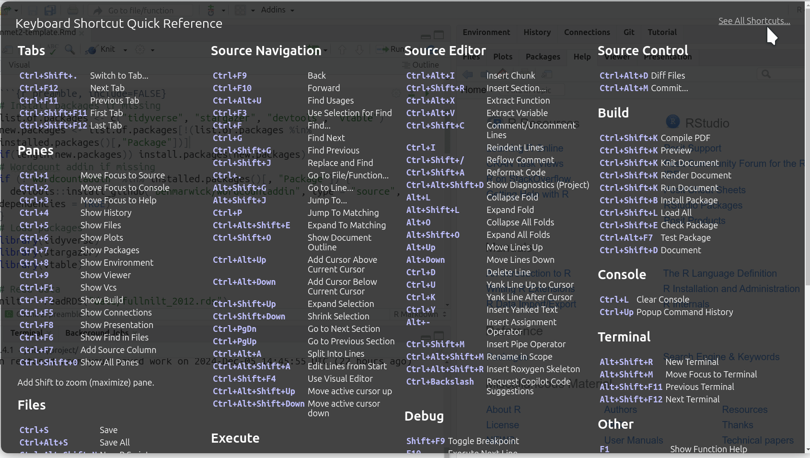{fig-alt="RStudio's dark Keyboard Shortcut Quick Reference overlay, with columns of shortcuts headed Tabs, Panes, Files, Source Navigation, Execute, Source Editor, Debug, Source Control, Build, Console, Terminal and Other, and a 'See All Shortcuts...' link at the top right."}

Here are also some of the common shortcuts covered across these reference pages:

  | What it does                                                              | Shortcut                                               |
  | ---                                                                       | ---                                                    |
  | Run the current line, or the selected lines                               |               |
  | Run the current code chunk (see [Code chunks](code-chunks.qmd#run-chunk)) |             |
  | Insert a new code chunk (see [Code chunks](code-chunks.qmd#inserting))    |             |
  | Keyboard Shortcuts Help                                                   |              |
  | [Save the current file]{.new}                                             | []{.new}               |
  | [Insert the pipe, `|>`]{.new}                                             | []{.new}   |
  | [Insert the assignment arrow, `<-`]{.new}                                 | []{.new}                 |
  | [Turn the selected lines into comments, or back]{.new}                    | []{.new}   |
  | [Restart R]{.new}                                                         | []{.new} |
  | [Cancel unfinished code or stop running code in the Console]{.new}        | []{.new}                                |
  | [Clear the Console]{.new}                                                 | []{.new}                             |

Note, on some Windows computers the 'Insert a new code chunk' annoyingly does not work as it is already used by a Windows shortcut to insert an alternative version of the letter 'i' that is used in some languages. I think this issue has never been fixed as it may be unique to UK keyboards, whereas most of the developers of RStudio are based elsewhere.

### Cheat sheets {#cheat-sheets}

It is also possible to access cheat sheets for R Markdown (as well as ones for ggplot2 and dplyr!) from within RStudio, from Help > Cheat Sheets:

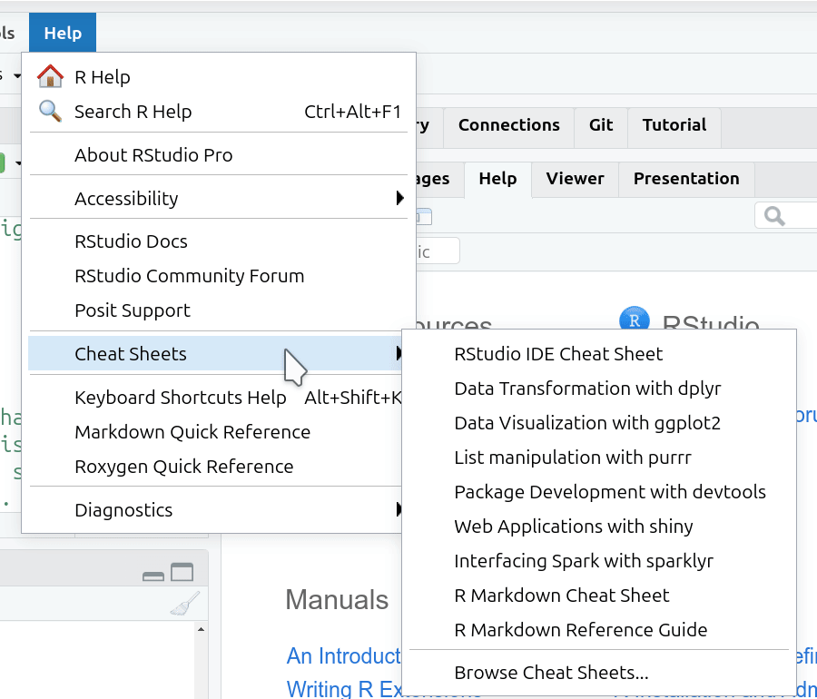{fig-alt="RStudio's Help menu open with Cheat Sheets highlighted and its submenu listing RStudio IDE Cheat Sheet, Data Transformation with dplyr, Data Visualization with ggplot2, List manipulation with purrr, Package Development with devtools, Web Applications with shiny, Interfacing Spark with sparklyr, R Markdown Cheat Sheet, R Markdown Reference Guide and Browse Cheat Sheets...."}

The 'RStudio IDE Cheat Sheet' at the top of the list is the one for RStudio itself with a shorter overviewer of its panes etc!
