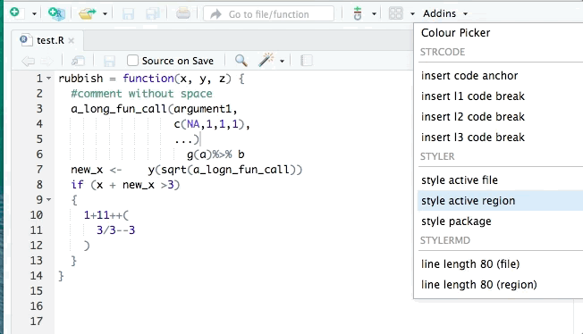
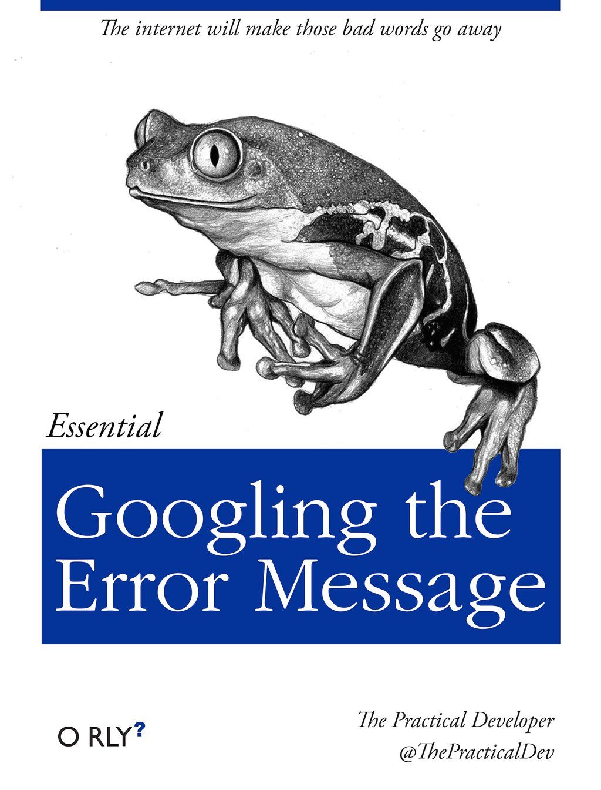
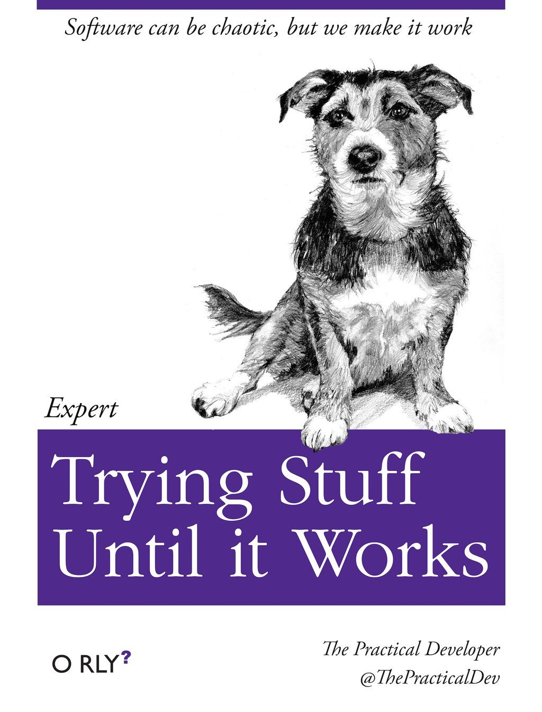
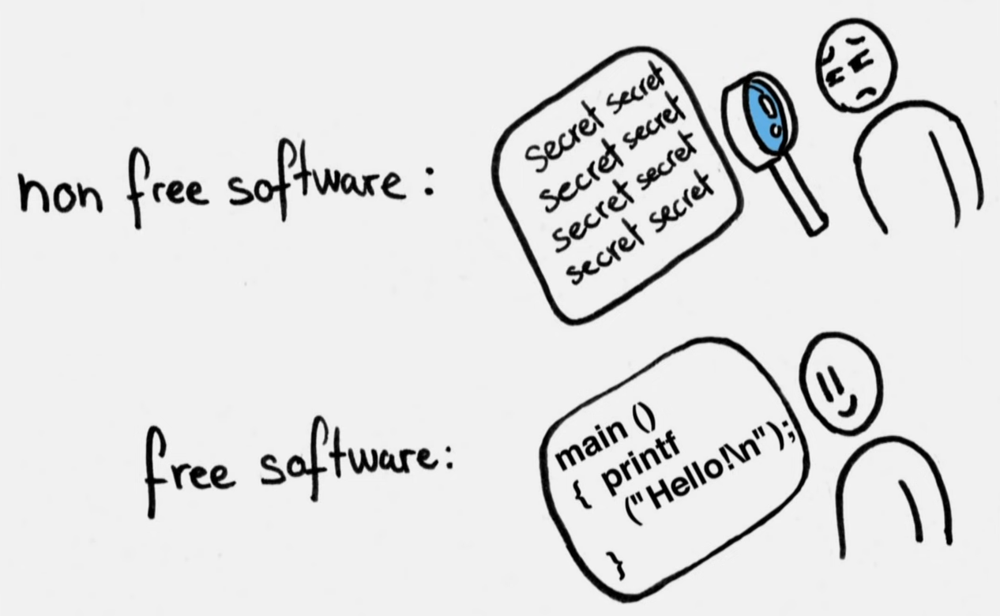
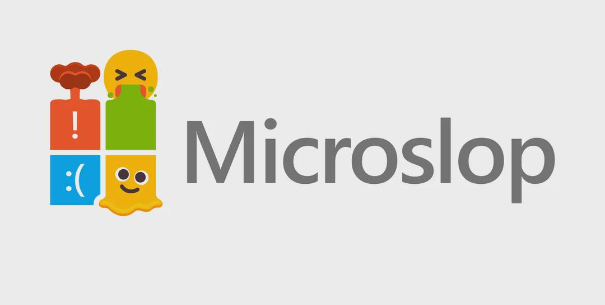

---
format:
  constellate-revealjs:
    code-overflow: wrap
title: "The Social Life of Digital Data"
subtitle: "Working with Wikipedia and WikiData"
author:
  - name: "Alasdair Stewart"
    roles: ["Lecturer in Social & Public Policy"]
module: "Working with Digital Data: Data Project 2"
module-code: "SPS5072"
week: 7
---

# Outline

- About the Course
- 'Data Project'
- Assessments
- R and Coding
- Wikipedia & WikiData

# About the Course

## Course Content

- **Week 7**: The Social Life of Digital Data
- **Week 8**: Data Genres and Contexts
- **Week 9**: Emotions in Digital Data
- **Week 10**: Data Links
- **Week 11**: Data Otherwise

## Aims

Some of the core aims of the course:

- Working with 'messy data'
- Producing new and useful datasets
- Developing advanced data management skills
- Diversity of data in digital spaces
- Critical considerations around sampling & representation and notions of truth & authenticity

## Quick Warm-Up Discussion {.surface-activity}

What comes to mind when you hear the phrases:

- Digital data
- Data management
- Messy data
- Digital spaces

## ILOs

- Recognise the role played by theory for social constructions of reality in the context of digital data.
- Demonstrate data management skills for collecting, storing and preparing digital data for analysis.
- Assess the value of data management, analysis approaches within their disciplinary context.
- [Complete an analysis of collected digital data.]{.mark}

## 'Data Project'

The other core aims of the course:

- Working through a 'whole project'.
- Autonomy in choosing what data to work with.
- Space to focus on the skills you are most keen to develop.

## Importantly

You are free to use data we directly cover on the course or your own choice of digital data.

This includes secondary data available through the UK Data Archive.

Only real limitation is it cannot be data that requires ethics permission to collect and analyse. (Feel free to drop me an email if unsure!)

We are also using a broad definition of 'data project' where main thing looking for is a sensible justified 'analysis focus'.

# Assessments {.surface-assessments}

## [Summative Portfolio](https://abers.github.io/data-project-2/assessments/summative-assessment.html) {.surface-assessments}

**Word count**: 2,400 words (±10%). Three equally weighted components, with a recommended word count of 800 words each.

**Deadline**: 12 noon, 9th December 2026

The portfolio provides an opportunity to explore an analysis focus of your choice, using analyses of selected digital data to answer analysis questions. 'Analysis focus' here refers to a broad research problem, area for exploration, intellectual puzzle, or similar.

## [Formative Assessment](https://abers.github.io/data-project-2/assessments/formative-assessment.html) {.surface-assessments}

**Word count**: 300-400 words.

**Deadline**: 18th November 2026

This optional formative assessment is an opportunity to receive feedback on your planned analyses for the summative portfolio.

## Questions about the assessments? {.surface-activity}

# Don't Panic {.surface-dont-panic}

We recognise it can feel like a big step up in complexity moving from the basics of R to working with different datasets and forms of analysis...

## Resources {.surface-dont-panic}

I am currently developing some general reference materials on basics of R, R Markdown, and a few key packages.

I will keep chipping away at this as we go - expanding it with additional content that we cover over the next five weeks.

Please let me know if there is anything you are experiencing issues with - including if trying to work with data not directly covered on the module.

## Learning R {.surface-dont-panic}

Whilst `?` / `help()` are great for quickly accessing documentation not all documentation is that accessible for beginners until you build some initial familarity with code.

**However**, the open source / open knowledge communities around R are phenomenal!

For most things you plan to do with R, there is a strong likelihood there is open access content someone has created for it. Just take a look at [The Big Book of R](https://www.bigbookofr.com/).

## Learn little tips and tricks {.surface-dont-panic}

When typing in an R Markdown file or in the Console, if you pause at any point, RStudio will pop-up an auto-completion list using objects available in your R environment. You can then use up/down arrows to navigate through the list.


## Let R Help You {.surface-dont-panic .smaller}

::: {.columns}
::::: {.column width="45%"}
There are packages that act as 'Addins' for RStudio that can do things like flag potential errors / enforce a coding 'style'...

`install.packages("lintr")`

... and auto-format your code to match a particular style.

`install.packages("styler")`

Linters are great to help spot issues that cause errors. Formatters help make your code tidy and consistent as you go.
:::::

::::: {.column width="55%"}

:::::
:::

## Key Skills {.surface-dont-panic .smaller}

::: {.column width="30%"}
As a beginner, knowing how to read and modify code is a more useful than memorising code.

Even when become an expert, most coding boils down to searching out the right resources and trying different things until it works.
:::

::: {.columns}
::::: {.column width="35%"}

:::::

::::: {.column width="35%"}

:::::
:::

## Coding patterns {.surface-dont-panic}

It may appear monsterous at first, but code is powerful!

[ggplot2](https://ggplot2.tidyverse.org/index.html) provides a 'grammar of graphics' where many basic plots can be described with just 3-4 lines of code.

```{r}
#| echo: true
#| eval: false

DATA_FRAME |> ggplot(aes(x = VARIABLE1, ...)) + # <1>
  geom_...() + # <2>
  labs(title = "Title text", x = "Label for x-axis", ...) # <3>
```

1. We pass the DATA_FRAME we wish to create a plot with to `ggplot()` with the aesthetic mapping - `aes()` - of the VARIABLES(s) we wish to use.
2. We use `geom...()` to specify which type of plot we want, such as `geom_boxplot()` or `geom_histogram()`.
3. We specify any text labels to use - `labs()`.

## Coding patterns 2 {.surface-dont-panic}

```{r}
#| include: false

library(ggplot2)
library(carData)
```

```{r}
#| echo: true
#| renderings: [light, dark]

BEPS |> ggplot(aes(x = vote, fill = vote)) +
  geom_bar() +
  scale_fill_manual(values = c("Conservative" = "blue", "Labour" = "red", "Liberal Democrat" = "orange")) +
  labs(title = "Reported vote in the 2001 general election",
     x = "Party voted for", y = "Number of respondents", fill = "Party")
```

# Digital Data

## Real because its constructed

> Statistical tools allow the discovery or creation of entities that support
> our descriptions of the world and the way we act on it. Of these objects, [we
> may say both that they are real and that they have been constructed]{.mark}, once
> they have been repeated in other assemblages and circulated as such, cut
> off from their origins—which is after all the fate of numerous products.
> - **Alain Desrosières** 1998, *The Politics of Large Numbers*, page 3

## The social production of data {.smaller}

To butcher an (in)famous phrase of Derrida's: "there is no outside social".

All data is socially produced and mediated - and, in turn, the 'datafication' of society shapes and mediates knowledge production.

To say something is constructed is not necessarily to say it is not 'real'. Instead, it is important to consider how data is produced and the implications and effects of that - both for the data itself and society.

For instance, Fourcade and Healy argue that digital capitalism with its pervarsive - and ever widening and penetrating - scoring and ranking systems means we now line in an "ordinal society" (2024).

## Naïve positivists? {.smaller}

Whilst quantitative methods texts do not always engage in onto-epistemology in same way as qualitative methods, quantitative researchers are always grappling with questions about knowledge and reality:

- Arguments over how to define, measure, and count phenomena
- Variables as proxy measures and 'latent' variables
- Assumptions in selecting more appropriate quantitative methods for a research question
- 'Falsify' rather than 'prove' a capital 'T' 'Truth'
- Survey design to reduce bias in response (including research into how best to design questions)
- Recognition and discussions of limitations

## The 'God Trick' and 'Strong Objectivity' (Haraway and Harding) {.smaller}

- Illusion of objectivity used to present information as neutral and universal 'view from nowhere', hiding positionality and biases.
- All knowledge, including data, is 'situated', it is produced under specific conditions by people in specific positions that influences what they see and know.
- Situated knowledge does not reject 'objectivity', but look to 'maximise objectivity' – embracing and being transparent that knowledge is always partial, contingent, and context-dependent
- 'Strong objectivity' critique also engages with understandings and transparency of method and analysis

## Making sense of the mess {.smaller}

> one should never speak of ‘data’ – what is given – but rather of sublata, that is, of ‘achievements’
> - **Latour** 1999, *Pandora's Hope*, page 42

When we speak of 'messy data' in the narrow practical sense, it largely is in context of data collection and 'cleaning' to produce data that can work with.

However, we can also think more critically about 'messy data' in the broader sense, the inherently in inextricably 'messiness' of all data production - which from 'strong objectivity' influenced perspective is not something to remove but engage with.

Importantly - as social phenomena, data production and analysis exist and take part within social struggles...

## The Open Definition

> Open means [anyone can freely access, use, modify, and share for any purpose]{.mark} - subject, at most, to requirements that preserve provenance and openness.
> - Open Knowledge Foundation

Free (as in freedoms) and open software arose in the 1980s and 90s in debates about softwaare - mixing academic and programming cultures. Since then it has expanded to encompass open knowledge, open data, open science, and more.

--------------------------------------------------------------------------------



## Social Life of R {.smaller}

R is free and open source - released under the GPL license, meaning any changes to it must also be released as free and open source software.

Core to the four foundamental freedoms of free software - use, study, share, and improve - is not just individual freedoms but "so the whole community benefits".

Literally thousands of people contribute to R and its wider ecosystem - with 25,611 (and counting) R packages available via [CRAN](https://cran.r-project.org/).

Before R became the predominant option for data analysis within academia, universities were paying for expensive proprietary software nowhere near as powerful.

Going further back, companies using proprietary formats could mean sharing analysis projects required others needed to also pay / subscribe for the software.

# Wikipedia & 'Knowledge Communities'

## Discussion {.surface-activity}

Have a brief skim of [Wikipedia's Policies and guidelines](https://en.wikipedia.org/wiki/Wikipedia:Policies_and_guidelines).

Consider:

- Implications these have for knowledge production
- The importance placed on community and what that means in practice
- Notions of knowledge and 'neutral point of view'
- Considerations of 'representation' (Both in narrow and broad senses)

## Digital Traces {.surface-activity .smaller}

Wikipedia's openness provides us with rare opportunity to see a form of knowledge production in detail. Among the various 'digital traces' available to view are 'talk' pages - where the community debates changes.

Examples:

- [Renaming Kiev to Kyiv](https://en.wikipedia.org/wiki/Talk:Kyiv/Archive_7#Requested_move_28_August_2020)
- [Renaming Israel-Gaza War to Gaza war](https://en.wikipedia.org/wiki/Talk:Gaza_war/Archive_48#Requested_move_17_January_2025)
- [FAQ over the naming of the current Derry page](https://en.wikipedia.org/wiki/Talk:Derry/FAQ)
- [Decisions to delete and restore page for Clarice Phelps](https://en.wikipedia.org/wiki/Wikipedia:Deletion_review/Log/2020_January_31#Clarice_Phelps)

## 'Wokepedia'? {.surface-activity .smaller}

Over the years Wikipedia has been accused on having a liberal or left wing political bias - with various competing alternatives setup. One latest such endevour is Elon Musk's [Grokipedia](https://grokipedia.com/), created using his genAI chatbot Grok.

Find an article in your area of research interest on Grokipedia and compare it to an equivalent article from Wikipedia. What differences can you find in how they approach the topic?

**WARNING**: Alongside various misinformation and psuedo-science, Grokipedia does contain discriminatory views, including white nationalist conspiracy theories. It is perfectly OK if you prefer to read articles / reports about Grokipedia instead. Wikipedia itself has a [page on Grokipedia](https://en.wikipedia.org/wiki/Grokipedia).

## 'Neutrality' in LLMs {.surface-activity .smaller}

> ChatGPT shouldn’t have political bias in any direction.
> - OpenAI, 9th October 2025

Take a look at OpenAI's [Defining and evaluating political bias in LLMs](https://openai.com/index/defining-and-evaluating-political-bias-in-llms/).

Read the "Defining measurable axes of bias" section.

Select one of the 'biased' and 'reference' response pairs from the "Examples of grader outputs" section.

Consider:

- What is being marked-up as 'bias' and differences between the 'biased' and 'reference' responses?
- Would you consider the 'reference' response more 'neutral' and 'objective'?

## Hate?

::: {.hate-img}

:::


