```{r}
#| include: false

knitr::opts_knit$set(root.dir = file.path(Sys.getenv("QUARTO_PROJECT_DIR"), "week10"))
```

(I mentioned at our in-person session that you can use code to also created 'stylised' maps, so here is an initial very quick guide for how you can do that with example maps ordered from simple to more complex. At the moment it is just sections and code. It likely will not be until mid-December that I have time to go back through adding in better text explanations, but hopefully at least the code for the initial 3-4 maps are easy enough to follow and understand what bits of code can tweak and change to create your own maps.)

- We will be using [rcityviews](https://koenderks.github.io/rcityviews/) (Which has documentation that explains each of the main functions and includes further examples!)
- It has its own official tutorial covering [making maps of Amsterdam](https://koenderks.github.io/rcityviews/)
- All the map data - and how this still fits in this week's theme of 'linking data' comes from the wonderful [OpenStreetMap](https://www.openstreetmap.org/#map=17/55.895114/-4.307520) project - an open source community run project. **Anyone** can contribute to their maps, and many Google Maps alternatives use it. It is also used frequently by NGOs following natural disasters as people can actively update the maps based on what roads are closed/open, where shelters are setup, etc. Indeed, not only can you edit OpenStreetMap online, you can also download various Android and iOS apps so can edit maps when out and about!
- OpenStreetMap like Wikipedia is a 'wonder of the modern internet' and testament to the power of open source. Steve Coast who started OpenStreetMap in 2004 did so whilst a student and balking at the Ordnance Survey - the UK's national mapping agency - which despite being publicly funded charged a fee to use their data. So, Steve did what many would think ridiculous - he decided to make his own maps, with the first data added created by him cycling around London with... a GPS unit attached to... a laptop. Yet because communities can flourish around open source - when done right - there are over 11 million accounts registered with OpenStreetMap today, with maps of various levels of detail that span the entire globe.
- All OpenStreetMap data is entirely free to use as long as you acknowledge the community of contributors - which `rcityviews` does for us automatically. (Note, however, if for personal use only - i.e. creating an image which not sharing publicly with others, then it is OK to not include the copyright notice.)

## Install

```{r}
#| eval: false

install.packages("remotes")
remotes::install_github("koenderks/rcityviews", dependencies = TRUE)
```

## Load

```{r}
#| eval: false

library(tidyverse)
library(rcityviews)
```

## Folder creation

```{r}
#| eval: false

dir.create("images")
```

## OSM Servers

When we create a new area in `rcityviews` it downloads data from OpenStreetMap. Given the amount of data and OSM being a free service, downloads can be slow and fail if the servers are overloaded at the time you try them.

**However**, as long as you keep the same R session active, the data only needs to be downloaded once and then all maps you create for the same area do not need to repeat the downloads. This data is 'cached' though so if you restart/stop the R session, you will need to re-download the data again.

By default `rcityviews` seems to use the OSM server based in Germany.

You can check the status of the server with:

```{r}
#| eval: false

osmdata::overpass_status()
```

There are a lot of OSM servers - though all are community / individual volunteer run with varying download speeds and data coverage. Whilst a few are paid for - given the costs of running a server - there are plenty that are free to use.

You can see a [list of OSM server instances](https://wiki.openstreetmap.org/wiki/Overpass_API#Public_Overpass_API_instances) online. If the default server is overloaded with requests, you can switch servers - and check the status - with:

```{r}
#| eval: false

osmdata::set_overpass_url("WEB-ADDRESS-OF-SERVER-TO-TRY-HERE")
osmdata::overpass_status()
```

For example, you could replace "WEB-ADDRESS..." in the above with `"https://maps.mail.ru/osm/tools/overpass/api/interpreter"`. The web addresses can use are all listed in the list of OSM server instances linked above.

Sometimes though all servers might be busy and you might just need to try again at a different time of day.

## Creating our areas

```{r}
#| eval: false

glasgow_city <- new_city(name = "Glasgow", country = "Scotland",
                         lat = 55.87, long = -4.27)

uofg_campus <- new_city(name = "University of Glasgow", country = "",
                        lat = 55.87144, long = -4.288488)
```

To find these for any spot, go to [openstreetmap.org](https://www.openstreetmap.org/), find the place, right-click on it and choose "Show address". The two numbers that appear in the search box are the latitude, then the longitude.

Alternatively, `rcityviews` has a list of pre-built cities:

```{r}
#| eval: false

list_cities(match = "Glasgow")
```

However, using new_city() makes it easier to pick exact spot and pass in custom labels to use.

## Map 1: Simple

**Important**, `rcityviews` documentation recommends writing two code chunks. One to create and save the map, and the other to view it. This (1) means you are not constantly redownloading data (2) not having to run code to generate the images each time.

In other words -

**Run only once - once image is created you do not need to run this code chunk ever again**

```{r}
#| eval: false

cityview(name = glasgow_city, filename = "images/glasgow_city_1.png")
```

**Run to view image**

```{r}
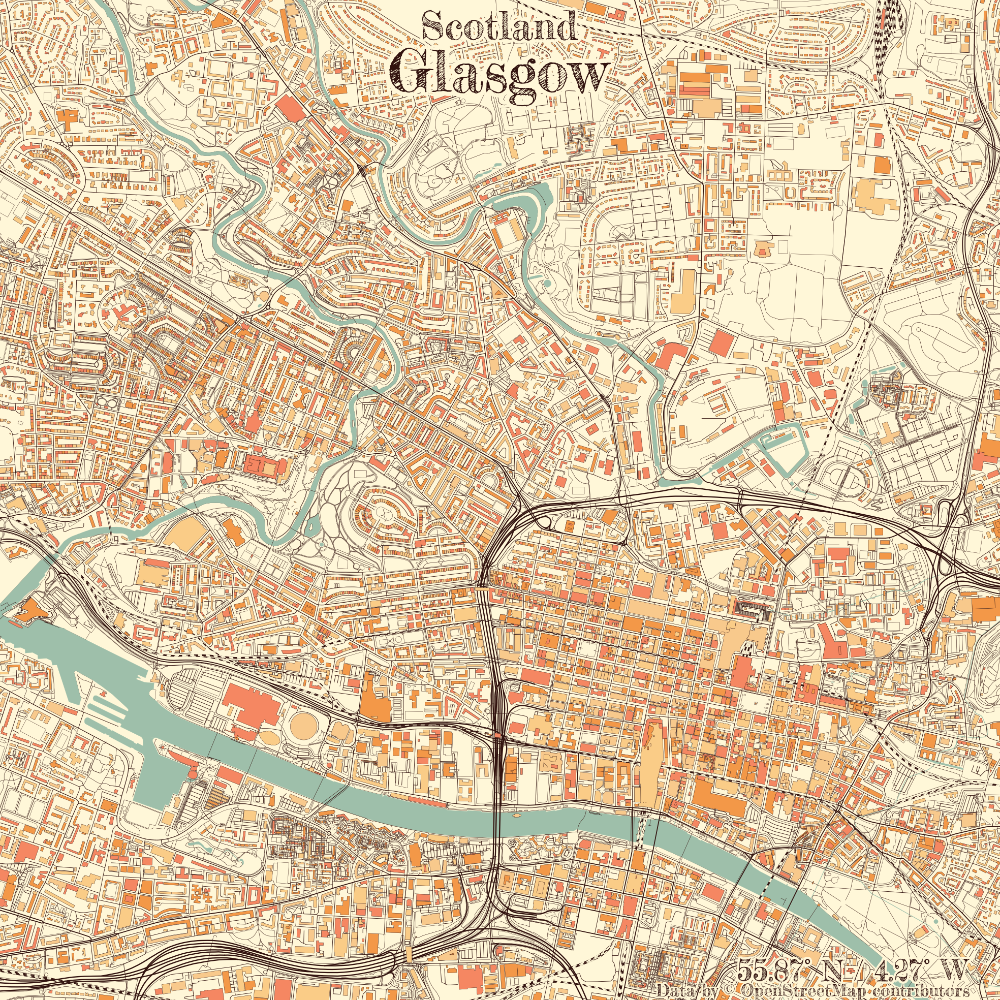
```

## Map 2: Theme+border

```{r}
#| eval: false

cityview(name = glasgow_city, theme = "rouge", border = "square",
         filename = "images/glasgow_city_2.png")
```

```{r}
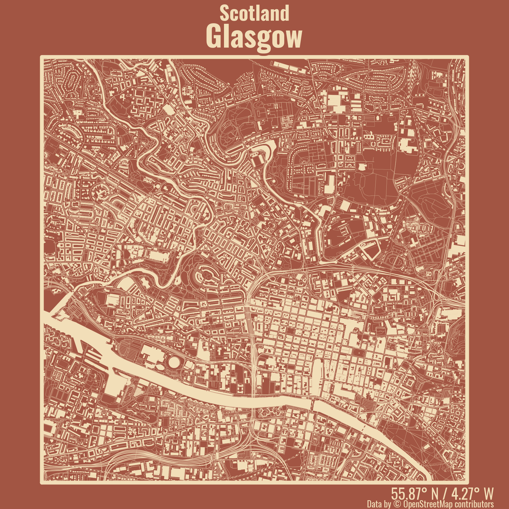
```

## Map 3: Zoom

```{r}
#| eval: false

cityview(name = uofg_campus, zoom = 3, theme = "modern", border = "hexagon",
         legend = TRUE, filename = "images/uofg_campus_1.png")
```

```{r}
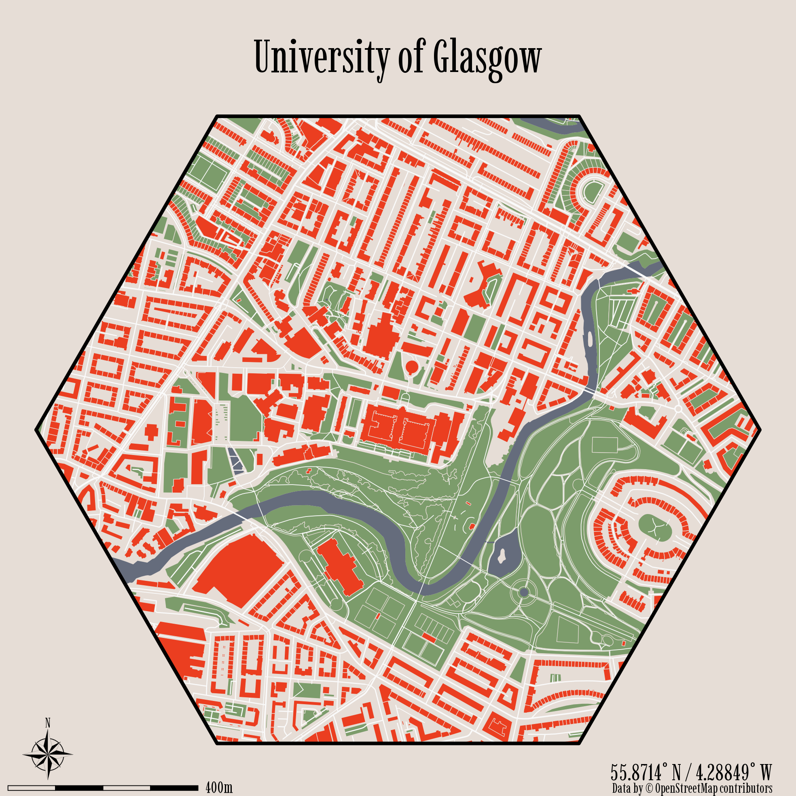
```

## Map 4: Changing fonts

```{r}
#| eval: false

batik_theme <- city_themes("batik")
batik_theme$font$family <- "serif"

cityview(name = glasgow_city, theme = batik_theme, border = "decagon",
         filename = "images/glasgow_city_3.png")
```

```{r}
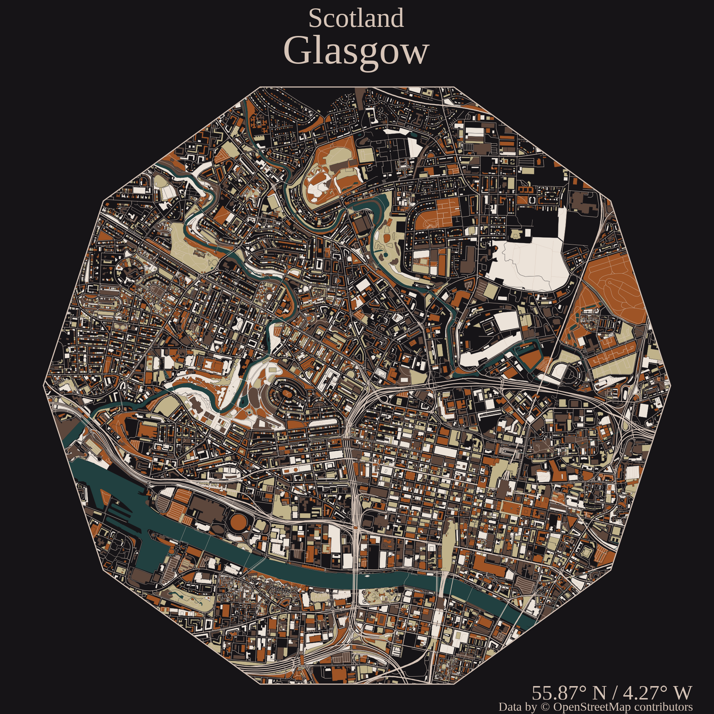
```

## Map 5: Fonts and texture

```{r}
#| eval: false

comic_theme <- city_themes("comic")
comic_theme$font$family <- "sans"
comic_theme$font$face <- "bold"
comic_theme$font$append <- " ~ "

cityview(name = uofg_campus, zoom = 3, theme = comic_theme, halftone = "black",
         filename = "images/uofg_campus_2.png")
```

```{r}
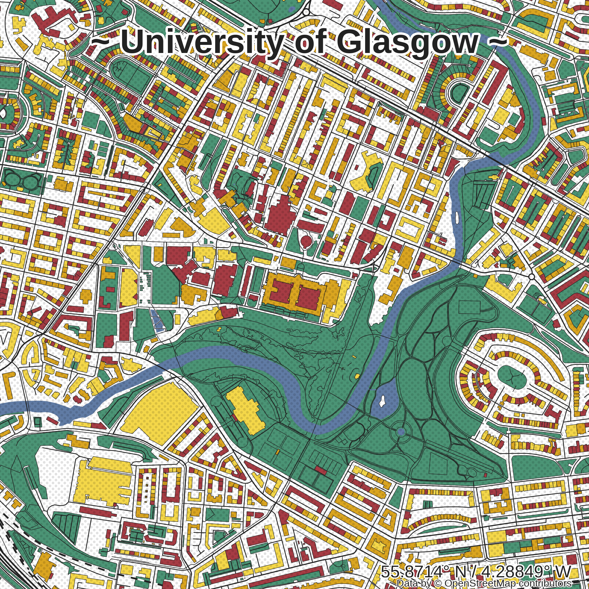
```

## Map 6: Customising theme's colours

A lot of software use mix of named (e.g. `darkgreen`) and **hex codes** (e.g. `#3259a6`) for colours. You can use online [colour pickers](https://htmlcolorcodes.com/color-picker/) to get the hex code for any colour. The colour names you can use keep expanding, but you can also find [lists of named colours](https://www.w3schools.com/colors/colors_names.asp) online, but they might not cover all options that are now available.

```{r}
#| eval: false

delftware_theme <- city_themes("delftware")
delftware_theme$font$family <- "Oswald"
delftware_theme$colors$water <- "#3259a6"
delftware_theme$colors$waterlines <- "#3259a6"

cityview(name = glasgow_city, theme = delftware_theme,
         filename = "images/glasgow_city_4.png")
```

```{r}
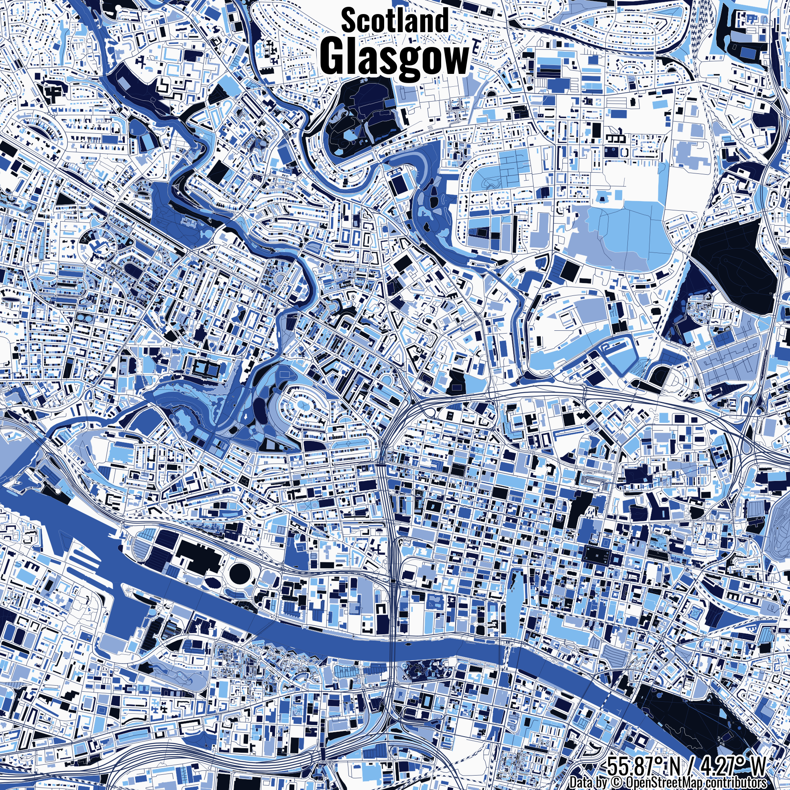
```

## Map 7: Custom colour scheme

Let's use the ever wonderful and dapper [Catppuccin colour palette](https://catppuccin.com/palette/) to create a custom colour scheme.

```{r}
#| eval: false

macchiato_theme <- city_themes("modern")
macchiato_theme$size$streets$path <- 0.1
macchiato_theme$colors <- list(
  background = "#24273a",
  water      = "#637baf",
  waterlines = "#637baf",
  landuse    = c("#4a6047", "#3e503e"),
  contours   = "#24273a",
  streets    = "#c4b0ad",
  rails      = c("#7bbcb3", "#24273a"),
  buildings  = c("#a86170", "#ae7961", "#926656",
                 "#bfaa82", "#ad9b9b", "#8286b2"),
  text       = "#f5e6cd",
  textshadow = "#181926"
)
```

We can now reuse that theme as we like:

```{r}
#| eval: false

cityview(name = uofg_campus, zoom = 3, theme = macchiato_theme,
         filename = "images/uofg_campus_3.png")
```

```{r}
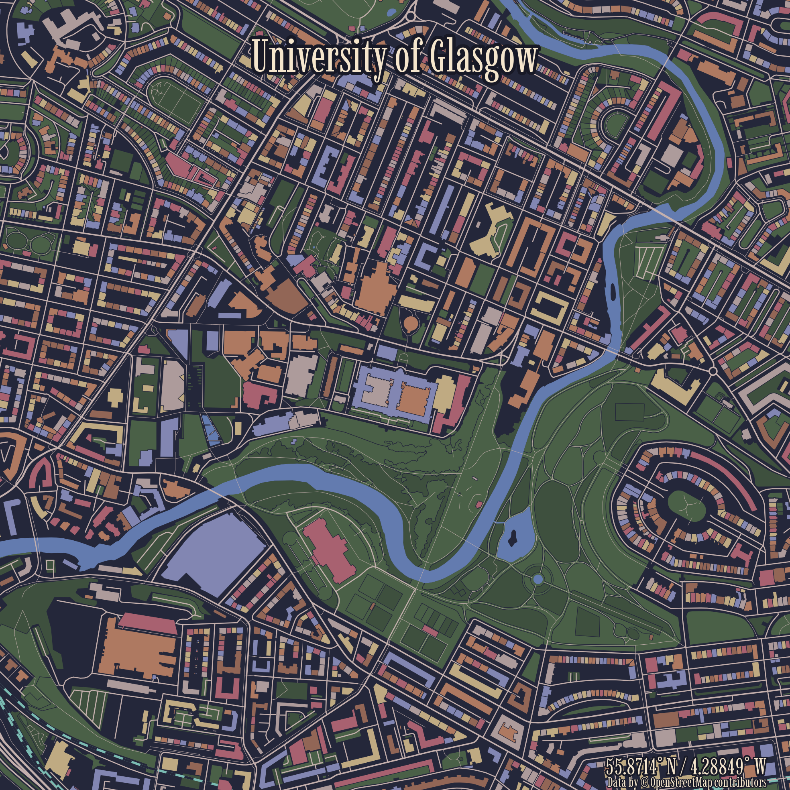
```

## Map 8: Reusing custom scheme

We can reuse our custom theme created above - and continue to tweak it if needed.

Let's create a new `macchiato_glasgow_theme` that starts with the same value as our `macchiato_theme` created above with some tweaks to the customisation -

```{r}
#| eval: false

macchiato_glasgow_theme <- macchiato_theme
macchiato_glasgow_theme$font$scale <- 1.3
macchiato_glasgow_theme$colors$text <- "#cad3f5"
macchiato_glasgow_theme$colors$buildings <- c("#8286b2", "#8286b2", "#8c72b1", "#8c72b1",
                                              "#ae86a6", "#a86170", "#ae7961", "#bfaa82",
                                              "#5b6078", "#5b6078")
```

```{r}
#| eval: false

cityview(name = glasgow_city, theme = macchiato_glasgow_theme,
         filename = "images/glasgow_city_5.png")
```

```{r}
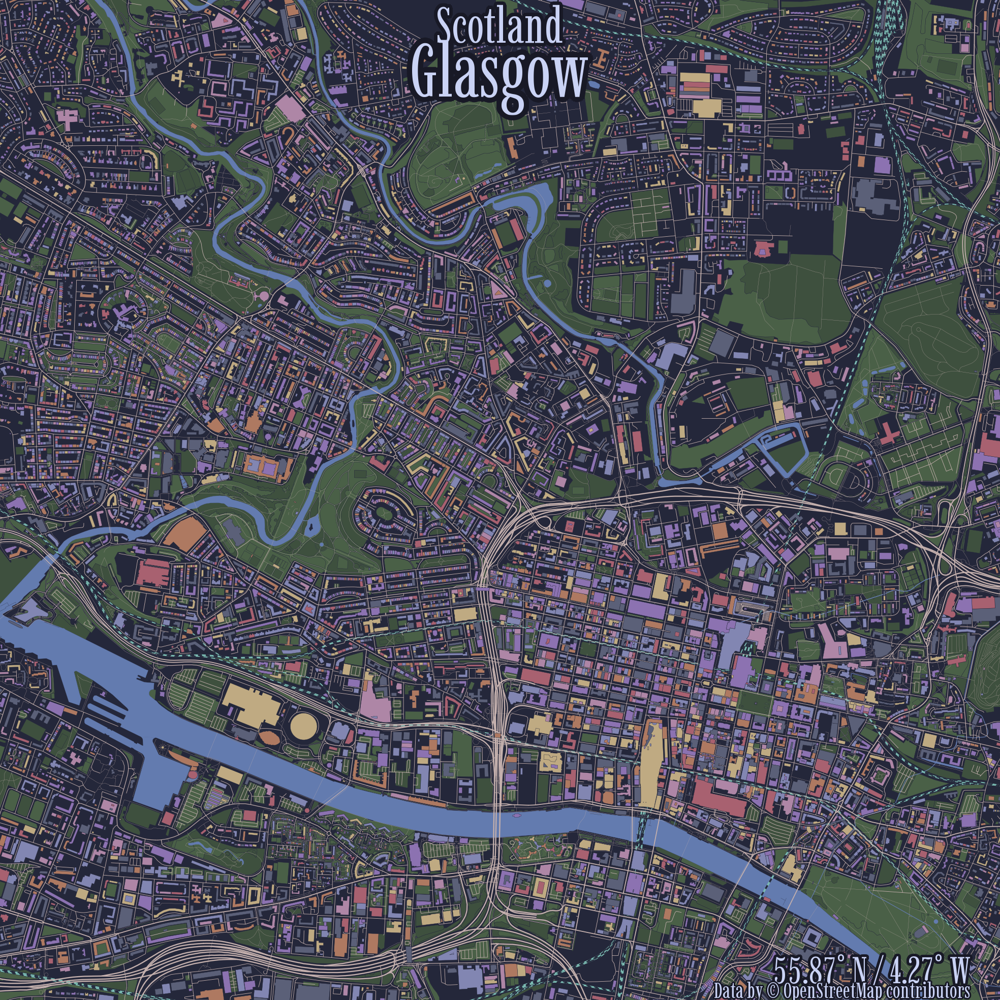
```

## Map 9: Adding labels with ggplot

Let's first create a custom theme that is slightly easier to parse:

```{r}
#| eval: false

clear_theme <- city_themes("original")
clear_theme$font$scale <- 0
clear_theme$size$streets$path <- 0.1
clear_theme$colors$buildings <- c("#e3c9a1", "#d9b382")
clear_theme$colors$contours <- "#b8a990"
clear_theme$colors$landuse <- "#cfe3c4"
clear_theme$colors$water <- "#a9cfe6"
clear_theme$colors$waterlines <- "#a9cfe6"
```

(Note, you will not always need this level of customisation this is just to show another example of customising colours etc.)

We are going to create a new area and map centred to the north side of campus (using OSM again - see above when created our original campus area - to get the lat and long)

```{r}
#| eval: false

uofg_buildings <- new_city(name = "University of Glasgow", country = "",
                           lat = 55.8727, long = -4.2893)

uofg_buildings_map <- cityview(name = uofg_buildings, zoom = 10,
                               theme = clear_theme)
```

We next need to get the lat and long of specific buildings that we want to label on this map. To get the latitude and longitude of a place, find it on [openstreetmap.org](https://www.openstreetmap.org/), right-click on it and choose 'Show address':

```{r}
#| echo: false

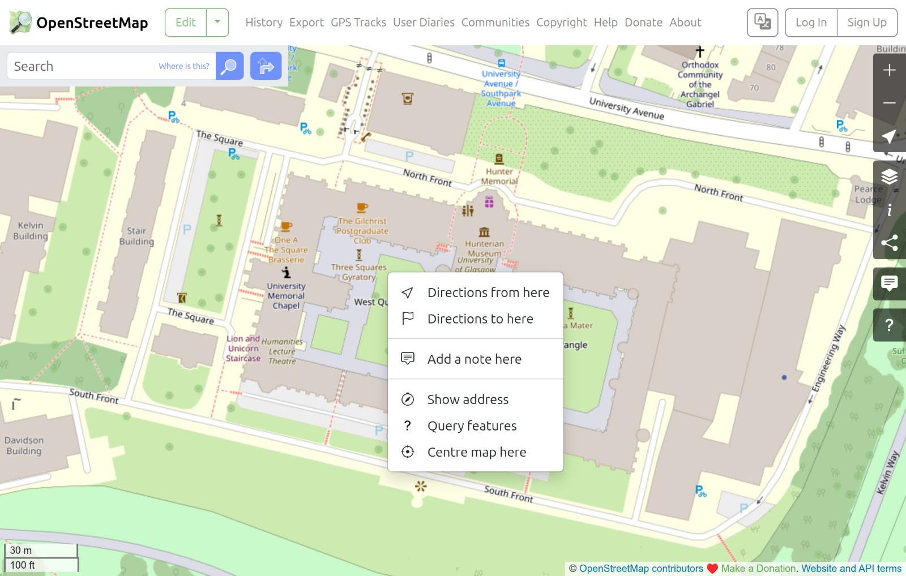
```

The two numbers that then appear in the search box at the top left are the latitude and then the longitude of the point you clicked on, which the map marks with a red pin:

```{r}
#| echo: false

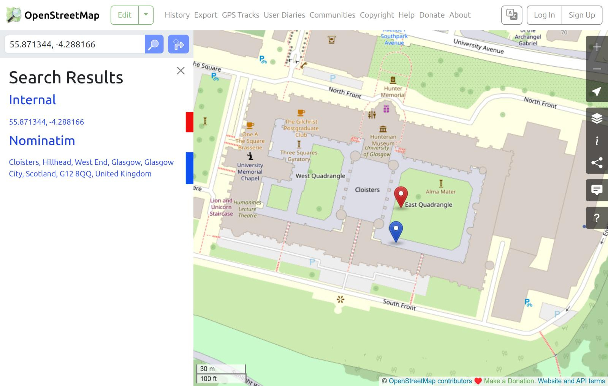
```

(Rest stll under construction: I realise the code is much more complex here so will eventually get bullet point breakdowns added too / see if can find way to achieve similar output with simpler code)

```{r}
#| eval: false

building_labels <- tibble(
  building = c("Gilbert Scott Building", "University Library",
               "Miller Building\n(42 Bute Gardens)", "25 Bute Gardens"),
  lat      = c(55.87149, 55.87335, 55.87377, 55.87434),
  long     = c(-4.288544, -4.28909, -4.289887, -4.289425),
  side     = c("below", "right", "left", "right")
)
```

```{r}
#| eval: false

place_labels <- function(labels, zoom) {
  sides <- c("above", "below", "left", "right")
  if (!all(labels$side %in% sides)) {
    stop('Values must be one of the following: "above", "below", "left" or "right".')
  }

  gap <- 150 / zoom

  labels |>
    mutate(
      gap_lat    = gap / 111000,
      gap_long   = gap / (111000 * cos(lat * pi / 180)),
      label_lat  = case_when(side == "above" ~ lat + gap_lat,
                             side == "below" ~ lat - gap_lat,
                             .default = lat),
      label_long = case_when(side == "right" ~ long + gap_long,
                             side == "left"  ~ long - gap_long,
                             .default = long),
      hjust      = case_when(side == "right" ~ "left",
                             side == "left"  ~ "right",
                             .default = "center"),
      vjust      = case_when(side == "above" ~ "bottom",
                             side == "below" ~ "top",
                             .default = "middle")
    ) |>
    select(-gap_lat, -gap_long)
}

get_inner_map <- function(map) {
  inner_map <- map$plot_env$plot
  if (is.null(inner_map)) {
    stop("No map found. Provide get_inner_map() a map made with cityview().")
  }
  inner_map
}

finish_map <- function(labelled_map, map) {
  cowplot::ggdraw(labelled_map) + map$layers[-1] + map$theme
}
```

```{r}
#| eval: false

building_labels <- building_labels |>
  place_labels(zoom = 10)

labelled_map <- get_inner_map(uofg_buildings_map) +
  geom_point(data = building_labels, aes(x = long, y = lat),
             shape = 21, size = 14, stroke = 3, colour = "white", fill = "#c8102e") +
  geom_label(data = building_labels,
             aes(x = label_long, y = label_lat, label = building,
                 hjust = hjust, vjust = vjust),
             fontface = "bold", size = 13, lineheight = 0.9,
             colour = "white", fill = "#1d3557")

labelled_map <- finish_map(labelled_map, uofg_buildings_map) +
  annotate("label", x = 0.99, y = 0.012, hjust = 1, size = 9,
           label = "Data by © OpenStreetMap contributors")
```

```{r}
#| eval: false

ggsave("images/uofg_campus_4.png", plot = labelled_map,
       width = 500, height = 500, units = "mm", dpi = 100)
```

```{r}
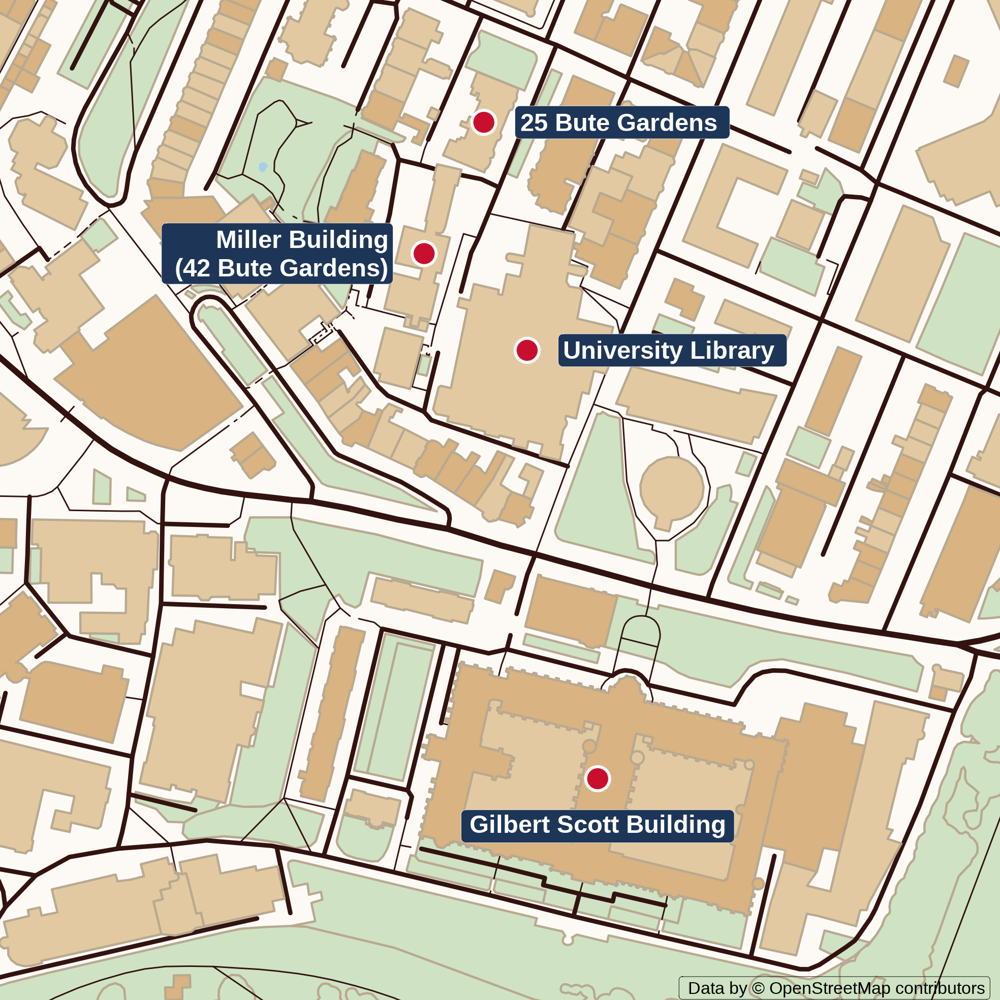
```
