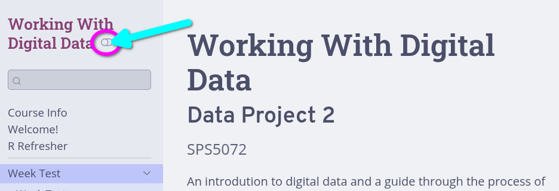

Welcome to the course pages, these are work-in-progress. I'll have more content up before our first session on the 3rd November and, hopefully, most of the initial reference content up before the 10th.

As some initial useful to know information:

## Documentation

Thanks to the wonders of the R downlit package, most code on these webpages is automatically linked to its online documentation.

Give it a try - clicking on either `library` and `ggplot2` in the code block below will take you to their respective documentation:

```{r}
#| eval: false

library(ggplot2)
```

## Protect Your Eyes

The site is setup to follow your system theme. However, on most university computers that will mean light mode. If you prefer dark mode, there is a toggle in the top-left of the page in the sidebar after the course title.


